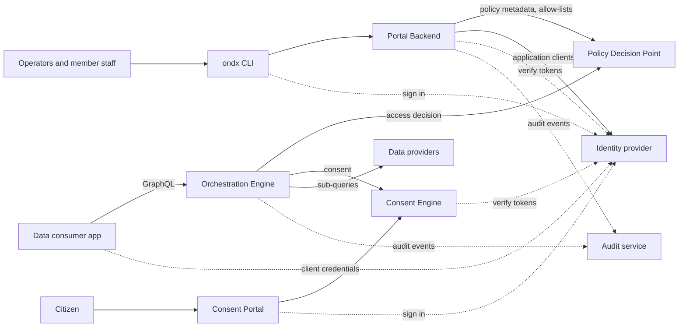
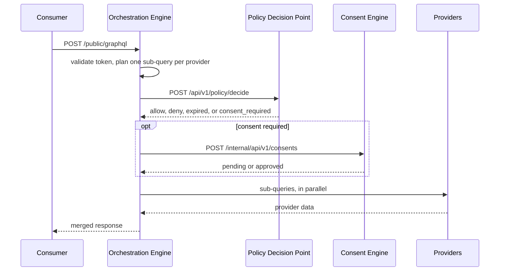

# Architecture

OpenNDX is a data exchange. A consumer sends one GraphQL query; the platform decides each field, asks the person when the field requires consent, fetches the allowed fields from the organizations that hold them, and returns one answer. Who it is for, and the local ports, are in the [README](README.md).

## System context

The identity provider in Docker Compose is ThunderID. The audit service is [Argus](https://github.com/LSFLK/argus), and it is optional. Data providers are systems the operator connects. Sample providers for local use are under [dev/](dev/README.md).

## Request flow

Field policy is in [cmd/pdp/POLICY_MODEL.md](cmd/pdp/POLICY_MODEL.md). Consent states are in [cmd/ce/CONSENT_LIFECYCLE.md](cmd/ce/CONSENT_LIFECYCLE.md).

## Functional requirements

| ID | Requirement |
|---|---|
| FR-1 | A consumer sends one GraphQL query to the Orchestration Engine and receives one response. |
| FR-2 | The engine validates the caller's token against the identity provider's JWKS, issuer, and audience before it runs the query. |
| FR-3 | Every requested field is decided by the Policy Decision Point. A field missing either `requiresAllowlist` or `requiresConsent` is rejected at registration. |
| FR-4 | When the decision is `consent_required` and no approved consent exists, the Consent Engine records a pending consent and the response includes a consent link. The engine does not fetch the field. |
| FR-5 | Only the person whose token subject matches the consent's `ownerId` can approve, reject, or revoke it. |
| FR-6 | Approved consent and access grants expire. Revocation takes effect on the next read. |
| FR-7 | A consent bypass is stored only with a non-empty legal basis, and the decision reports the `audit.consent_bypassed` obligation. |
| FR-8 | The engine fetches the allowed fields from the providers in parallel and merges them. A provider failure nulls that provider's fields and still returns the others. |
| FR-9 | The Orchestration Engine has no database and does not persist provider payloads. |
| FR-10 | Members, schemas, applications, policy, and grants are managed through the Portal Backend, which keeps the Policy Decision Point and the identity provider in step with what it stores. |

## Technology stack

| Layer | Choice | Version in this repo |
|---|---|---|
| Services and `ondx` | Go | 1.26.4 (`go.mod`) |
| Consent Portal | TypeScript, React, Vite | React 19, Vite 7 |
| Portal builds | Node.js, pnpm | Node 24+ |
| Databases | PostgreSQL, one per service that stores data | 16 (`postgres:16-alpine`) |
| Consumer API | GraphQL (`gqlparser` v2) | |
| Management APIs | HTTP JSON, OpenAPI 3.0.3 | `cmd/*/openapi.yaml` |
| Caller authentication | OAuth 2.0 access tokens, JWT, checked via JWKS | |
| Operator login | OAuth 2.0 authorization code with PKCE | `ondx` |
| Reference identity provider | ThunderID | `ghcr.io/thunder-id/thunderid:1.0.1` |
| Shared libraries | `github.com/OpenNSW/core` | Apache-2.0 |
| Metrics | OpenTelemetry, Prometheus exposition | optional, [observability/](observability/README.md) |
| Audit | Argus | optional |

Unit tests for the Policy Decision Point and Portal Backend use SQLite in memory. The services that store data use PostgreSQL when deployed.

## Where to go next

| Task | Guide |
|---|---|
| Install and run locally | [README](README.md#quick-start) |
| Run one service, run tests, fork, upstream, downstream | [Development guide](docs/contributing/development.md) |
| Use a running system | [Walkthrough](dev/WALKTHROUGH.md) |
| Deploy a release tag or a fork | [Deploy](docs/DEPLOY.md) |
| Release notes, images, and the CLI | [Release guide](docs/RELEASE.md) |
