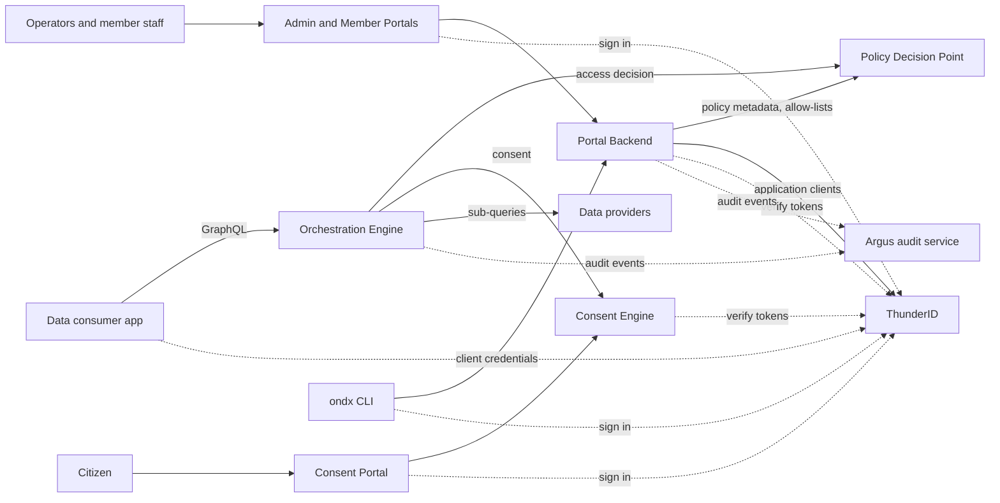

# OpenNDX

An open-source data exchange platform. Data consumers ask for citizens' data through one GraphQL gateway; the platform checks the consumer's access, gets the citizen's consent where required, fetches the data from the organizations that hold it, and returns one merged answer.

## Architecture



Each core service keeps its own PostgreSQL database. Detail for every component is in its README, linked below.

| Component | Role | Port | Docs |
|---|---|---|---|
| Orchestration Engine (OE) | Federated GraphQL gateway for data requests | 4000 | [cmd/oe](cmd/oe/README.md) |
| Policy Decision Point (PDP) | Field-level policy metadata, application allow-lists, access decisions | 8082 | [cmd/pdp](cmd/pdp/README.md) |
| Consent Engine (CE) | Consent lifecycle: request, approve, reject, expire, revoke | 8081 | [cmd/ce](cmd/ce/README.md) |
| Portal Backend (PB) | Management API for members, schemas, applications (to be renamed Management Server) | 8083 | [cmd/pb](cmd/pb/README.md) |
| `ondx` CLI | Operator command line for the Portal Backend | n/a | [cmd/ondx](cmd/ondx/README.md) |
| Consent Portal | Citizen app to approve or revoke consent | 5173 | [portals/apps/consent](portals/apps/consent/README.md) |
| Admin Portal | Operator app: members and submission review (not in Compose) | n/a | [portals/apps/admin](portals/apps/admin/README.md) |
| Member Portal | Member staff app: schemas and applications (not in Compose) | n/a | [portals/apps/member](portals/apps/member/README.md) |
| ThunderID | Identity provider bundled for local use | 8090 | [thunderid/](thunderid) |
| Audit service | [Argus](https://github.com/LSFLK/argus), optional audit log | 3001 | external |
| PostgreSQL | Databases for the services above | 5432 | [init-db.sql](init-db.sql) |
| Mock providers | Sample data providers for local use | 9090, 9091, 8080 | [dev/](dev/README.md) |

Ports are the Docker Compose defaults, and each can be changed in `.env`.

### How a data request flows

1. A consumer gets a token from the identity provider and sends a GraphQL query to the Orchestration Engine.
2. The Orchestration Engine asks the Policy Decision Point whether the consumer may read each field, and which fields need the data owner's consent.
3. If consent is needed, the Consent Engine records a pending request. The consumer receives a consent link, the citizen approves it in the Consent Portal, and the consumer repeats the query.
4. The Orchestration Engine fetches the data from the providers in parallel and returns the merged result.

Providers, schemas, applications and their access are set up beforehand through the Portal Backend, using the portals or `ondx`. Details: [Orchestration Engine](cmd/oe/README.md#how-it-works).

## Quick start

You need Docker with Compose.

```bash
git clone https://github.com/openndx/openndx-core.git
cd openndx-core
docker compose up --build
```

This starts PostgreSQL, ThunderID, the Policy Decision Point, Consent Engine, Orchestration Engine, Portal Backend, the Consent Portal and the audit service. Every setting has a local default, so no `.env` is needed; to override any, copy `.env.example` to `.env`. The local secrets all default to `1234`; never reuse them outside local development. The audit service is built from its GitHub source, so the first build needs network access.

The [end-to-end walkthrough](dev/WALKTHROUGH.md) takes it from there: mock providers, registering members and schemas with `ondx`, granting an application access, citizen consent, and a query that returns data. The Admin and Member Portals are not in Compose; see their READMEs.

## Working on the code

Install Go 1.26+, Node 24+ with pnpm (for the portals), Docker and Make, then:

```bash
make help                        # all commands
make setup-all                   # git hooks, Go modules, portal dependencies
make validate-test <service>     # tests
make quality-check <service>     # format, lint, security
make run <service>               # run one service
```

`<service>` is `orchestration-engine`, `policy-decision-point`, `consent-engine`, `portal-backend`, `consent-portal`, `admin-portal` or `member-portal`. Each component README has its own run, test and configuration details. [.env.example](.env.example) lists every variable `compose.yml` reads.

To install the `ondx` CLI, see [its README](cmd/ondx/README.md#install).

## Documentation

- **Start here:** [end-to-end walkthrough](dev/WALKTHROUGH.md), [mock providers](dev/README.md), [`ondx` tutorial](docs/TUTORIAL-ondx-cli.md)
- **Components:** the table above
- **Contributing:** [CONTRIBUTING.md](CONTRIBUTING.md), [development guide](docs/contributing/development.md), [pull requests](docs/contributing/pull-requests.md), [reporting issues](docs/contributing/reporting-issues.md)
- **Releases:** [docs/RELEASE.md](docs/RELEASE.md)
- **Contributor and ops references (refresh pending):** [Makefile usage](docs/MAKEFILE_USAGE.md), [code quality setup](docs/LOCAL_CODE_QUALITY_SETUP.md), [integration tests](tests/integration/README.md), [CI workflows](.github/workflows/README.md), [observability stack](observability/README.md)

## Security and license

Report vulnerabilities as described in [SECURITY.md](SECURITY.md), not in public issues. Licensed under the [Apache License 2.0](LICENSE). Participation is governed by the [Code of Conduct](CODE_OF_CONDUCT.md).
