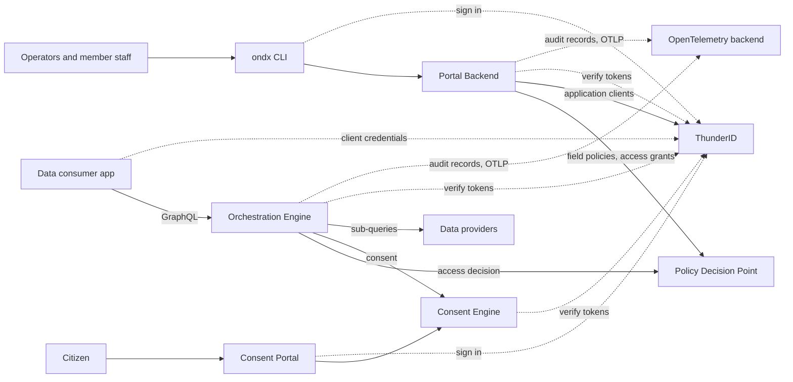

# OpenNDX

[](LICENSE)
[](https://github.com/openndx/openndx-core/releases/latest)
[](https://github.com/openndx/openndx-core/actions/workflows/integration-tests.yml)

Open National Data Exchange (OpenNDX) is an open-source data exchange platform by Lanka Software Foundation. A data consumer sends one query, and OpenNDX checks the consumer's access, gets the data owner's consent where required, fetches the data from the organizations that hold it, and returns one merged answer.

## Who it's for

- **Data consumers:** applications that need data held by other organizations. They send one GraphQL query instead of integrating with each organization.
- **Data providers:** organizations that hold the data. OpenNDX queries each provider over GraphQL, so a provider whose system has only a REST API puts a GraphQL adapter in front of it, as one of the [sample providers](dev/README.md) does.
- **Data owners:** the people the data is about. They approve, reject or revoke consent in the Consent Portal.
- **Operators and members:** the organization that runs an exchange, and the member organizations that register their providers' schemas and their consumers' applications with the `ondx` CLI or the management API.

## Key features

- **One query, many providers.** The [Orchestration Engine](cmd/oe/README.md) splits a GraphQL query into one sub-query per provider, runs them in parallel and merges the results.
- **Field-level access control.** Each field can require an access grant, the data owner's consent, both or neither, and every request is checked field by field ([policy model](cmd/pdp/POLICY_MODEL.md)).
- **Consent that data owners control.** Owners approve, reject or revoke each request in the [Consent Portal](portals/apps/consent/README.md), and approved consent expires ([consent lifecycle](cmd/ce/CONSENT_LIFECYCLE.md)).
- **Audited exceptions.** An administrator can let an application read a field without consent, with a legal basis and an expiry. The Orchestration Engine flags each such read in its audit events ([consent bypass](cmd/pdp/POLICY_MODEL.md#consent-bypass)).
- **Managed from a CLI or an API.** Members, schemas, applications and their access are registered with the [`ondx` CLI](cmd/ondx/README.md) or the [Portal Backend](cmd/pb/README.md) API.
- **Ready to deploy.** Every release publishes container images and `ondx` binaries, and the [Helm chart](deploy/helm/openndx/README.md) installs the services on Kubernetes.

## Status

OpenNDX is in initial development, before version 1.0, so a release can include breaking changes. Commit titles mark them with `!`, and the notes for each [release](https://github.com/openndx/openndx-core/releases) list the pull requests it includes.

## Architecture



The Policy Decision Point, Consent Engine and Portal Backend each keep their own PostgreSQL database; the Orchestration Engine has none. Detail for every component is in its README, linked below.

| Component                   | Role                                                                                                           | Port             | Docs                                                           |
| --------------------------- | -------------------------------------------------------------------------------------------------------------- | ---------------- | -------------------------------------------------------------- |
| Orchestration Engine (OE)   | Federated GraphQL gateway for data requests                                                                    | 4000             | [cmd/oe](cmd/oe/README.md)                                     |
| Policy Decision Point (PDP) | Field policies, access grants, access decisions                                                                | 8082             | [cmd/pdp](cmd/pdp/README.md)                                   |
| Consent Engine (CE)         | Consent lifecycle: request, approve, reject, expire, revoke                                                    | 8081             | [cmd/ce](cmd/ce/README.md)                                     |
| Portal Backend (PB)         | Management API for members, schemas, applications                                                              | 8083             | [cmd/pb](cmd/pb/README.md)                                     |
| `ondx` CLI                  | Operator command line for the Portal Backend                                                                   | n/a              | [cmd/ondx](cmd/ondx/README.md)                                 |
| Consent Portal              | Citizen app to approve or revoke consent                                                                       | 5173             | [portals/apps/consent](portals/apps/consent/README.md)         |
| Admin Portal                | Unsupported prototype; development paused; excluded from release images                                        | n/a              | [portals/apps/admin](portals/apps/admin/README.md)             |
| Member Portal               | Unsupported prototype; development paused; excluded from release images                                        | n/a              | [portals/apps/member](portals/apps/member/README.md)           |
| ThunderID                   | Identity provider bundled for local use                                                                        | 8090             | [thunderid/](thunderid)                                        |
| OpenObserve                 | Optional local receiver for the OE's and PB's audit records, started by `make up OTEL=1` or `make deps OTEL=1` | 5080             | [Viewing audit records](CONTRIBUTING.md#viewing-audit-records) |
| PostgreSQL                  | Databases for the services above                                                                               | 5432             | [init-db.sql](init-db.sql)                                     |
| Mock providers              | Sample data providers for local use                                                                            | 9090, 9091, 8080 | [dev/](dev/README.md)                                          |

Ports are the Docker Compose defaults. ThunderID's and the mock providers' ports are fixed; the others can be changed in `.env`, and [.env.example](.env.example) lists every variable that `compose.yml` reads.

The Consent Portal is actively maintained. Admin and Member Portal source is retained for reference, with no committed fixes or compatibility guarantees, and both portals are excluded from release images and Compose. Manage the platform through `ondx` or the Portal Backend API.

### How a data request flows

1. A consumer gets a token from the identity provider and sends a GraphQL query to the Orchestration Engine.
2. The Orchestration Engine checks the token, then asks the Policy Decision Point whether the consumer may read each field, and which fields need the data owner's consent.
3. If consent is needed, the Consent Engine records a pending request. The consumer receives a consent link, the citizen approves it in the Consent Portal, and the consumer repeats the query.
4. The Orchestration Engine fetches the data from the providers in parallel and returns the merged result.

Providers, schemas, applications and their access are set up beforehand through the Portal Backend, using `ondx` or the management API. Details: [Orchestration Engine](cmd/oe/README.md#how-it-works).

## Quick start

You need Docker with Compose.

```bash
git clone https://github.com/openndx/openndx-core.git
cd openndx-core
docker compose up --build
```

This starts PostgreSQL, ThunderID, the Policy Decision Point, Consent Engine, Orchestration Engine, Portal Backend and the Consent Portal. Every setting has a local default, so no `.env` is needed; to override any, copy `.env.example` to `.env`. The local secrets all default to `1234`; never reuse them outside local development. Audit records are dropped until an OpenTelemetry endpoint is set; [Viewing audit records](CONTRIBUTING.md#viewing-audit-records) shows how to send them to a local OpenObserve.

The [end-to-end walkthrough](dev/WALKTHROUGH.md) takes it from there: mock providers, registering members and schemas with `ondx`, granting an application access, citizen consent, and a query that returns data.

## Deploy

The [Helm chart](deploy/helm/openndx/README.md) installs the four services and the Consent Portal on Kubernetes, from the container images that each release publishes as `ghcr.io/openndx/<service>`. PostgreSQL, ThunderID, the data providers and the OpenTelemetry endpoint that receives audit records run outside the chart; its README lists what each needs. The [releases page](https://github.com/openndx/openndx-core/releases) lists each release's images, and the `ondx` CLI [installs](cmd/ondx/README.md#install) with Homebrew, an install script or `go install`.

## Dependencies

| Dependency                                                                       | Used for                                                                                                                                                                  | License            |
| -------------------------------------------------------------------------------- | ------------------------------------------------------------------------------------------------------------------------------------------------------------------------- | ------------------ |
| [PostgreSQL](https://www.postgresql.org/)                                        | The databases of the Policy Decision Point, Consent Engine and Portal Backend                                                                                             | PostgreSQL License |
| [ThunderID](https://github.com/thunder-id/thunderid)                             | Identity provider. It issues the tokens that the Orchestration Engine, Consent Engine and Portal Backend check, and the Portal Backend creates application clients in it. | Apache-2.0         |
| [OpenNSW/core](https://github.com/OpenNSW/core)                                  | Shared Go libraries, for example for configuration, databases and CORS                                                                                                    | Apache-2.0         |
| [OpenTelemetry](https://opentelemetry.io/)                                       | Exporting the Orchestration Engine's and Portal Backend's audit records over OTLP, through `OpenNSW/core/telemetry`                                                       | Apache-2.0         |
| [OpenObserve](https://github.com/openobserve/openobserve) (optional, local only) | Receives audit records and other telemetry under `make up OTEL=1` or `make deps OTEL=1`                                                                                   | AGPL-3.0           |

The Go and Node.js libraries are listed in [go.mod](go.mod) and [portals/apps/consent/package.json](portals/apps/consent/package.json).

## Standards

- [GraphQL](https://spec.graphql.org/) for consumer queries, and [GraphQL over HTTP](https://graphql.github.io/graphql-over-http/draft/) for the calls to providers.
- [OAuth 2.0](https://www.rfc-editor.org/rfc/rfc6749) access tokens: the client credentials grant for data consumers, and the authorization code grant with [PKCE](https://www.rfc-editor.org/rfc/rfc7636) for the Consent Portal and `ondx`.
- [JSON Web Tokens](https://www.rfc-editor.org/rfc/rfc7519), verified with the identity provider's [JSON Web Key Set](https://www.rfc-editor.org/rfc/rfc7517).
- [OpenAPI 3.0](https://spec.openapis.org/oas/v3.0.3) descriptions of the services' HTTP APIs, in each `cmd/<service>/openapi.yaml`.

## Exporting data

OpenNDX doesn't keep the data that consumers request: the Orchestration Engine has no database, and its [audit records](internal/audit/README.md) hold the fields requested and the data owner's ID, not the query text or the values in the providers' `data`. The platform's own records can be exported as JSON:

- members, schemas and applications, with the `--json` option of the `ondx` `list` and `get` commands, or through the [Portal Backend API](cmd/pb/README.md);
- field policies and access grants, from the Policy Decision Point at `GET /api/v1/policy/fields` and `GET /api/v1/policy/grants` ([API](cmd/pdp/README.md)).

## Privacy

OpenNDX is self-hosted. The organization that runs an exchange is responsible for the personal data in it, and the software sends no usage data or telemetry to Lanka Software Foundation. [PRIVACY.md](PRIVACY.md) describes what personal data each component keeps, how the design protects it, how data owners' requests are handled, and what deletion and retention support exists today.

## Documentation

- **Tutorial:** the [end-to-end walkthrough](dev/WALKTHROUGH.md), which runs the platform with the [mock providers](dev/README.md).
- **How-to guides:** [add a data provider](cmd/oe/PROVIDER_CONFIGURATION.md), [deploy with Helm](deploy/helm/openndx/README.md), [make a release](docs/RELEASE.md).
- **Reference:** each component's README, linked from the [table above](#architecture), with its configuration and `openapi.yaml`; the [policy model](cmd/pdp/POLICY_MODEL.md), the [consent lifecycle](cmd/ce/CONSENT_LIFECYCLE.md) and the [Portal Backend's authorization](cmd/pb/AUTHORIZATION.md); the [audit records](internal/audit/README.md); the [`ondx` CLI](cmd/ondx/README.md).
- **Contributor and ops references:** [integration tests](tests/integration/README.md), [Consent Engine metrics](cmd/ce/README.md#metrics), [viewing audit records](CONTRIBUTING.md#viewing-audit-records)

## Get help

- Ask questions and discuss ideas in [GitHub Discussions](https://github.com/openndx/openndx-core/discussions).
- Report bugs and suggest improvements with the [issue forms](https://github.com/openndx/openndx-core/issues/new/choose).
- Report security vulnerabilities as described in [SECURITY.md](SECURITY.md), not in public issues.

## Contributing

To build, test or run the services from source, see [CONTRIBUTING.md](CONTRIBUTING.md). It covers the prerequisites on each operating system, every `make` target, the ways to run the platform and how to submit a pull request. Participation is governed by the [Code of Conduct](CODE_OF_CONDUCT.md).

## License

Copyright Lanka Software Foundation. Licensed under the [Apache License 2.0](LICENSE).
