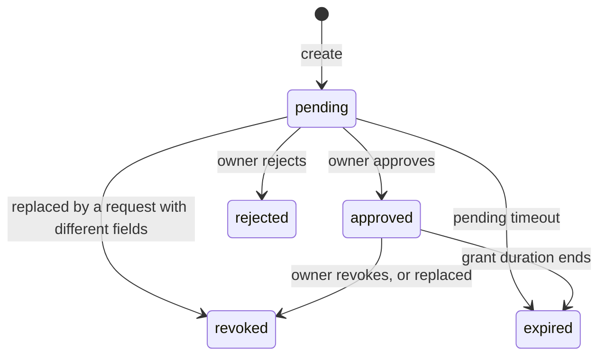

# Consent lifecycle

How the Consent Engine creates, decides and expires consents. The service overview is in the [README](README.md); request and response schemas are in [openapi.yaml](openapi.yaml).

## States

`rejected`, `expired` and `revoked` are final. A consumer that needs access again creates a new consent.

## Creating a consent

`POST /internal/api/v1/consents` is idempotent per `(ownerId, appId)`:

| Existing `pending` or `approved` consent | Result                                                                                                                                                                               |
| ---------------------------------------- | ------------------------------------------------------------------------------------------------------------------------------------------------------------------------------------ |
| None                                     | A new `pending` consent is created.                                                                                                                                                  |
| Same fields                              | The existing consent is returned unchanged.                                                                                                                                          |
| Different fields                         | The existing consent is set to `revoked` (with `updatedBy` = `System: revoked due to new consent with different fields`) and a new `pending` consent is created, in one transaction. |

A partial unique index on `(owner_id, app_id)` for `pending` and `approved` rows enforces the one-active-consent rule in the database.

Required in the request: `appId`, `consentRequirement.ownerId` and at least one entry in `consentRequirement.fields`, each with `fieldName` and `schemaId`. The fields are the `consentRequiredFields` that the Policy Decision Point returned.

The response is `{consentId, status, consentPortalUrl, fields}`. `consentPortalUrl` is present only while the consent is `pending`, and has the form `<consentPortalURL>?consentId=<uuid>`.

## Durations

| Setting         | Values                                        | Default    |
| --------------- | --------------------------------------------- | ---------- |
| `consentType`   | `realtime`, `offline`                         | `realtime` |
| Pending timeout | 1 hour for `realtime`, 24 hours for `offline` |            |
| `grantDuration` | `PT1H`, `PT6H`, `PT12H`, `P1D`, `P7D`, `P30D` | `PT1H`     |

The grant starts when the owner approves: `grantExpiresAt` is the approval time plus `grantDuration`. The Orchestration Engine sends no `grantDuration`, so consents it creates grant one hour of access.

## Expiry

There is no background job. A consent is marked `expired` the next time it is read or acted on:

- reading it by `ownerId` and `appId` (internal API) or by ID (portal API),
- listing the owner's consents,
- trying to approve, reject or revoke it.

The write is conditional on the status that was read, so a concurrent decision is never overwritten. Because of this, a consumer polling `GET /internal/api/v1/consents` always sees the effective status.

## Deciding in the portal

`PUT /api/v1/consents/{consentId}` accepts one action:

| Action    | Allowed from | Result                                                           |
| --------- | ------------ | ---------------------------------------------------------------- |
| `approve` | `pending`    | `approved`, sets `grantExpiresAt`                                |
| `reject`  | `pending`    | `rejected`                                                       |
| `revoke`  | `approved`   | `revoked` (`grantExpiresAt` is kept to show the withdrawn grant) |

Any other combination returns `409` with `CONSENT_NOT_PENDING` or `CONSENT_NOT_REVOCABLE`. The update is conditional on the current status, so when two decisions race exactly one wins.

## Who may decide

The portal API verifies the bearer token with the shared `internal/authn` package, the same one Portal Backend and the Orchestration Engine use. The token must be signed with RS256, RS384 or RS512 by a key in the JWKS at `idp.jwksURL`, carry a `kid` header, match `idp.issuer` and `idp.audience`, be unexpired (30 seconds of clock skew are allowed), and have `sub` and `client_id` claims. Anything else returns `401` with `{"error":"unauthorized","message":"..."}`.

The CE then takes the value of the claim named by `idp.subjectClaim` (default `sub`) as the owner; a token without that claim also returns `401`. That value must equal the consent's `ownerId`; otherwise the call returns `403`. So `ownerId`, which the Orchestration Engine takes from the data-owner identifier argument of the GraphQL query, must be the same identifier the identity provider puts in that claim. In the bundled stack that is the citizen's NIC, such as `FL-4829105736`: the query passes it as the `nic` argument, and the CE reads the `nic` claim. Use a claim whose value only the identity provider sets: whoever can choose its value can decide on that owner's consents. In the bundled ThunderID the citizens are the accounts in `users.yaml`, and the Consent Portal doesn't offer sign-up ([thunderid/README.md](../../thunderid/README.md#entries-for-local-use-only)).

Signing keys are fetched from `idp.jwksURL` on the first portal call and cached for 5 minutes. A token that names a key ID not in the cache forces one re-fetch, so rotated keys are picked up immediately. The CE exits at startup if `idp.jwksURL`, `idp.issuer` or `idp.audience` is missing, or if the JWKS URL or issuer is not a valid URL; an unreachable JWKS URL only makes portal calls fail with `401`.

## Database

`consent_records` (created by [schema.sql](schema.sql)):

| Column                                                         | Notes                                                                         |
| -------------------------------------------------------------- | ----------------------------------------------------------------------------- |
| `consent_id`                                                   | uuid primary key                                                              |
| `owner_id`, `app_id`, `app_name`                               | The data owner, the consumer application's `client_id`, and its display name. |
| `status`, `type`                                               | See above.                                                                    |
| `fields`                                                       | jsonb list of `{fieldName, schemaId, displayName, description, owner}`.       |
| `grant_duration`, `grant_expires_at`                           | Requested duration, and the expiry set on approval.                           |
| `pending_expires_at`                                           | Set while pending, cleared on a decision.                                     |
| `consent_portal_url`, `updated_by`, `created_at`, `updated_at` |                                                                               |

The service opens one connection pool (default 25 open, 5 idle, 1 hour lifetime, 30 minute idle timeout) through [`internal/database`](../../internal/database) and closes it on shutdown. It does not create or migrate tables. The `session_id` column is not used by any code path.
