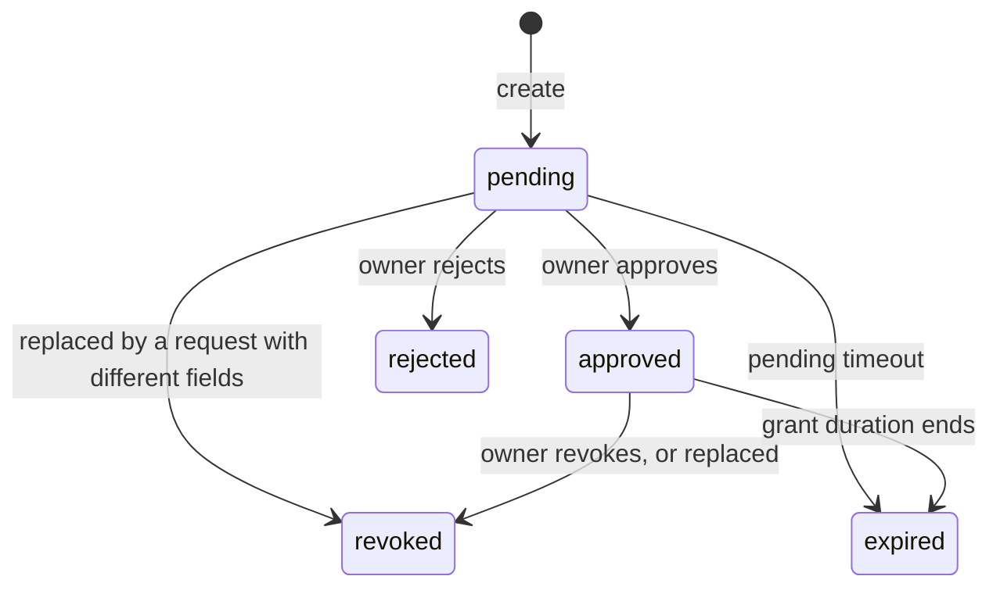

# Consent lifecycle

How the Consent Engine creates, decides and expires consents. The service overview is in the [README](README.md); request and response schemas are in [openapi.yaml](openapi.yaml).

## States

`rejected`, `expired` and `revoked` are final. A consumer that needs access again creates a new consent.

## Creating a consent

`POST /internal/api/v1/consents` is idempotent per `(ownerId, appId)`:

| Existing `pending` or `approved` consent | Result |
|---|---|
| None | A new `pending` consent is created. |
| Same fields | The existing consent is returned unchanged. |
| Different fields | The existing consent is set to `revoked` (with `updatedBy` = `System: revoked due to new consent with different fields`) and a new `pending` consent is created, in one transaction. |

A partial unique index on `(owner_id, app_id)` for `pending` and `approved` rows enforces the one-active-consent rule in the database.

Required in the request: `appId`, `consentRequirement.ownerId` and at least one entry in `consentRequirement.fields`, each with `fieldName` and `schemaId`. The fields are the `consentRequiredFields` that the Policy Decision Point returned.

The response is `{consentId, status, consentPortalUrl, fields}`. `consentPortalUrl` is present only while the consent is `pending`, and has the form `<CONSENT_PORTAL_URL>?consentId=<uuid>`.

## Durations

| Setting | Values | Default |
|---|---|---|
| `consentType` | `realtime`, `offline` | `realtime` |
| Pending timeout | 1 hour for `realtime`, 24 hours for `offline` | |
| `grantDuration` | `PT1H`, `PT6H`, `PT12H`, `P1D`, `P7D`, `P30D` | `PT1H` |

The grant starts when the owner approves: `grantExpiresAt` is the approval time plus `grantDuration`. The Orchestration Engine sends no `grantDuration`, so consents it creates grant one hour of access.

## Expiry

There is no background job. A consent is marked `expired` the next time it is read or acted on:

- reading it by `ownerId` and `appId` (internal API) or by ID (portal API),
- listing the owner's consents,
- trying to approve, reject or revoke it.

The write is conditional on the status that was read, so a concurrent decision is never overwritten. Because of this, a consumer polling `GET /internal/api/v1/consents` always sees the effective status.

## Deciding in the portal

`PUT /api/v1/consents/{consentId}` accepts one action:

| Action | Allowed from | Result |
|---|---|---|
| `approve` | `pending` | `approved`, sets `grantExpiresAt` |
| `reject` | `pending` | `rejected` |
| `revoke` | `approved` | `revoked` (`grantExpiresAt` is kept to show the withdrawn grant) |

Any other combination returns `409` with `CONSENT_NOT_PENDING` or `CONSENT_NOT_REVOCABLE`. The update is conditional on the current status, so when two decisions race exactly one wins.

## Who may decide

The portal API verifies the bearer token (RS256 only) and takes the value of the claim named by `IDP_SUBJECT_CLAIM` (default `sub`) as the owner. That value must equal the consent's `ownerId`; otherwise the call returns `403`. So `ownerId`, which the Orchestration Engine takes from the data-owner identifier argument of the GraphQL query, must be the same identifier the identity provider puts in that claim. In the bundled stack that is the citizen's `nic`.

Signing keys are fetched from `IDP_JWKS_URL` in the background at startup, and again whenever a token names a key ID the service does not have. Once any key is cached, a re-fetch happens at most once an hour. A missing or wrong URL is only a startup warning; portal calls then fail with `401` until a fetch succeeds. A key rotated within the hour may be rejected until the next allowed fetch.

## Database

`consent_records` (created by [schema.sql](schema.sql)):

| Column | Notes |
|---|---|
| `consent_id` | uuid primary key |
| `owner_id`, `app_id`, `app_name` | The data owner, the consumer application's `client_id`, and its display name. |
| `status`, `type` | See above. |
| `fields` | jsonb list of `{fieldName, schemaId, displayName, description, owner}`. |
| `grant_duration`, `grant_expires_at` | Requested duration, and the expiry set on approval. |
| `pending_expires_at` | Set while pending, cleared on a decision. |
| `consent_portal_url`, `updated_by`, `created_at`, `updated_at` | |

The service opens one connection pool (default 25 open, 5 idle, 1 hour lifetime, 30 minute idle timeout) through [`internal/database`](../../internal/database) and closes it on shutdown. It does not create or migrate tables. The `session_id` column is not used by any code path.
