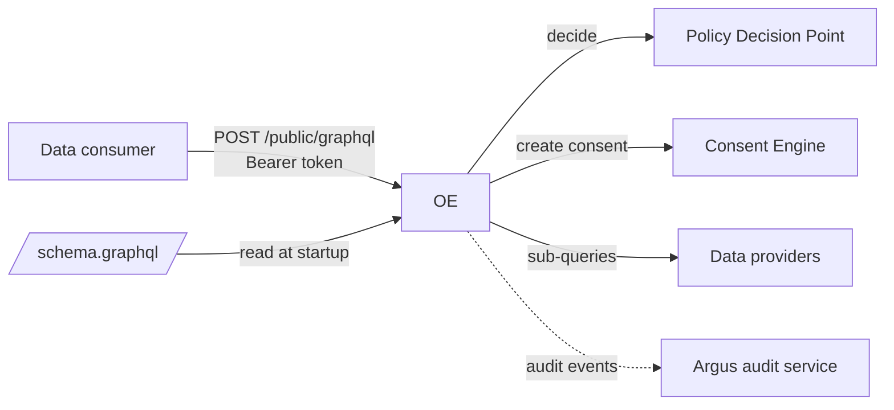
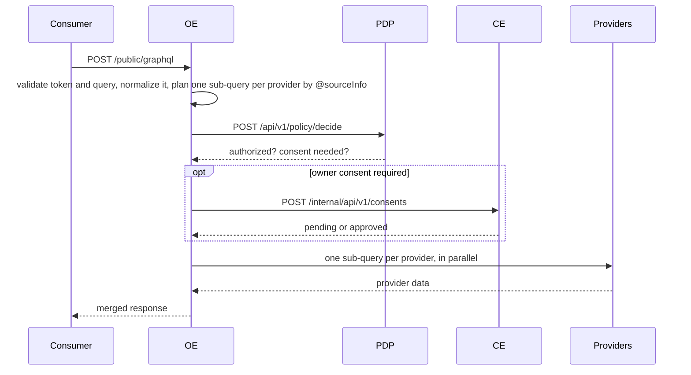

# Orchestration Engine (OE)

The data-exchange gateway. A data consumer sends one GraphQL query; the OE checks access with the Policy Decision Point, obtains the data owner's consent through the Consent Engine, fetches the data from the providers that hold it, and returns one merged response.

## Overview



The OE splits a consumer query into one sub-query per provider using `@sourceInfo` directives in its GraphQL schema, so consumers never see which provider holds which field. It reads that schema from a file at startup and keeps no database. The only callers are data consumers (machine clients).

## Quick start

With Docker Compose, the full stack including the OE (from the repo root):

```bash
docker compose up --build orchestration-engine
curl http://localhost:4000/health
```

Compose mounts `cmd/oe/config.docker.yaml` and `cmd/oe/schema.graphql` into the container. The sample providers are the mock APIs in [dev/](../../dev/README.md).

Native, from the repo root, with ThunderID from `docker compose up thunderid` for consumer tokens:

```bash
cp cmd/oe/config.example.yaml cmd/oe/config.yaml     # git-ignored
make run orchestration-engine
```

`make run` starts the service from `cmd/oe`, where it reads `config.yaml`; the schema is the `schema.graphql` next to it. To run from elsewhere, pass `-config path/to/config.yaml` or set `CONFIG_PATH`.

To send a real query you need a consumer token, registered policy metadata and an application grant. Follow the [walkthrough](../../dev/WALKTHROUGH.md), or the token and curl example in [dev/README.md](../../dev/README.md).

## Configuration

The OE reads one YAML file (`-config`, else `CONFIG_PATH`, else `config.yaml`) and the consumer schema file it names (`schemaPath`, default the `schema.graphql` next to it). Both are read once at startup; to change either, deploy the new file and restart. A value written as `"{{env:NAME}}"` or `"{{file:/path}}"` is read from the environment or a file, which is how secrets get in.

| `config.yaml` key | Meaning |
|---|---|
| `server`, `logging` | Port (default `4000`) and request timeout; log level and format. |
| `schemaPath` | The consumer schema file; default `schema.graphql`, resolved against the directory of the config file. |
| `foundationalIdArgName` | **Required.** Name of the query argument that identifies the data owner, for example `nic`. |
| `idp` | **Required.** Consumer token validation: `jwksURL`, `issuer`, `audience`. See [AUTHENTICATION.md](AUTHENTICATION.md). |
| `pdp.url` | PDP base URL. If empty, the OE skips authorization and consent checks (see Security). |
| `consentEngine.url` | Consent Engine URL **including** `/internal/api/v1`. |
| `audit` | Argus audit service URL, API key and actor identity. |
| `providers[]` | Data providers: `id` (the schema ID), `url`, optional `timeout`, `auth` and `tls`. See [PROVIDER_CONFIGURATION.md](PROVIDER_CONFIGURATION.md). |
| `argMappings[]` | How consumer arguments map to each provider's arguments. |

Every key with its default, and the error codes: [CONFIGURATION.md](CONFIGURATION.md).

## API

| Method and path | Auth | Purpose |
|---|---|---|
| `POST /public/graphql` | Bearer token | Federated query. Body `{query, variables, operationName}`; response `{data, errors}`. Only one `query` operation per request. |
| `GET /health` | none | `{"service": "orchestration-engine", "status": "healthy"}` |

[openapi.yaml](openapi.yaml) describes `/health`. `/public/graphql` is described here and in [AUTHENTICATION.md](AUTHENTICATION.md).

## How it works



- The consumer's identity is the token's `client_id`. It is sent to the PDP as `applicationId`.
- Each selected leaf field's `providerField` and `schemaId` become the `(schemaId, fieldName)` the PDP looks up, so every field must have policy metadata registered. Fields skipped with `@skip`/`@include` aren't sent.
- If consent is not yet approved, the response is HTTP 200 with `errors[0].extensions.code = CE_NOT_APPROVED`, plus `consentPortalUrl` and `consentStatus`. The citizen approves in the Consent Portal and the consumer repeats the query.
- Federation errors come back as HTTP 200 with `errors[].extensions.code` (`PDP_NOT_ALLOWED`, `CE_NOT_APPROVED`, `MISSING_IDENTIFIER`, and others; see [CONFIGURATION.md](CONFIGURATION.md#error-codes)). Only an unreadable body (`400`) or a missing or invalid token (`401`, JSON) use HTTP error statuses.
- When a provider fails, including with a non-2xx HTTP status, the fields it serves are `null` with a `PROVIDER_ERROR` at their `path`, and the failure is audited. The other providers' data is still returned, with HTTP 200.

## Security and deployment

> **Deployment security.** Only `/public/graphql` requires a token. `/health` is not authenticated; expose only `/public/graphql` to consumers.

- Consumer tokens are always verified against the IdP's keys (`idp.jwksURL`), issuer and audience ([AUTHENTICATION.md](AUTHENTICATION.md)).
- With `pdp.url` empty, the OE returns provider data without any authorization or consent check. Always set it.
- Keep provider and audit secrets out of the config file with `"{{env:NAME}}"` or `"{{file:/path}}"`.
- The OE sends no CORS headers, so browsers can't call it directly. Its callers are machine clients.
- Audit events (`DATA_REQUEST`, `POLICY_CHECK`, `CONSENT_CHECK`, `PROVIDER_FETCH`) go to Argus. If Argus is down, batches are lost.

## Development

```bash
make validate-test orchestration-engine        # tests with -race and coverage
go test ./cmd/oe/... ./internal/oe/... -count=1
make quality-check orchestration-engine
```

[HOW_TO_TEST.md](HOW_TO_TEST.md) covers unit and golden tests, changing the schema, and trying queries. The routes are registered in [main.go](main.go) and the config loader is [config.go](config.go). The rest is in [`internal/oe`](../../internal/oe): `federator` (query splitting and merging, and the `/public/graphql` handler; `federator/schema` loads the schema file), `auth`, `policy` and `consent` (clients), `provider`.

## More docs

- [CONFIGURATION.md](CONFIGURATION.md): all `config.yaml` keys, error codes, the schema file
- [AUTHENTICATION.md](AUTHENTICATION.md): token validation, `idp` settings, JWKS handling
- [PROVIDER_CONFIGURATION.md](PROVIDER_CONFIGURATION.md): adding a data provider
- [HOW_TO_TEST.md](HOW_TO_TEST.md): testing and manual checks
- [Policy Decision Point](../pdp/README.md) and [Consent Engine](../ce/README.md): the services the OE calls
