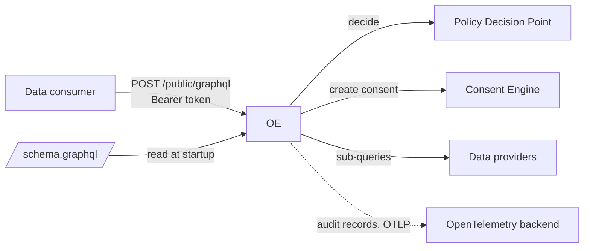
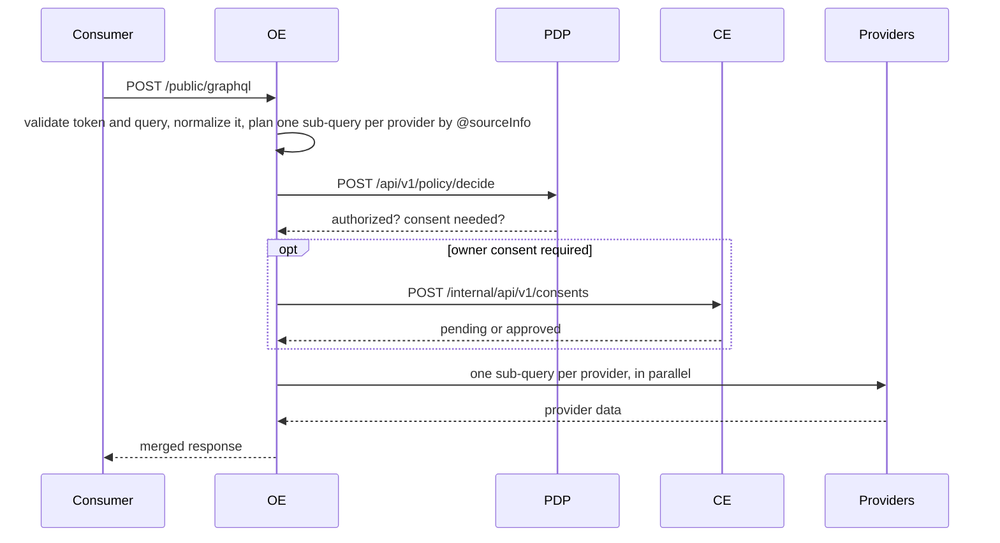

# Orchestration Engine (OE)

The data-exchange gateway. A data consumer sends one GraphQL query; the OE checks access with the Policy Decision Point, obtains the data owner's consent through the Consent Engine, fetches the data from the providers that hold it, and returns one merged response.

## Overview



The OE splits a consumer query into one sub-query per provider using `@sourceInfo` directives in its GraphQL schema, so consumers never see which provider holds which field. It reads that schema from a file at startup and keeps no database. The only callers are data consumers (machine clients).

## Quick start

With Docker Compose, from the repo root, start the full stack and the mock data providers:

```bash
docker compose up -d --build
docker compose -f dev/compose.yml up -d
curl http://localhost:4000/health
```

Compose mounts `cmd/oe/config.docker.yaml` and `cmd/oe/schema.graphql` into the container. The mock providers are described in [dev/](../../dev/README.md). `docker compose up --build orchestration-engine` rebuilds and starts only the OE, because the service declares no dependencies.

Natively, while the rest of the stack runs in Docker. No container calls the OE, so it can swap out on its own. Stop any other service you run natively first, since `make up` starts it in Docker on the same port (see [running the platform](../../CONTRIBUTING.md#running-the-platform)):

```bash
make up                                             # full stack and the mock providers
docker compose stop orchestration-engine
cp cmd/oe/config.example.yaml cmd/oe/config.yaml    # once; config.yaml is git-ignored
cd cmd/oe && go run .
```

Run from `cmd/oe`, the service reads `config.yaml` there; the schema is the `schema.graphql` next to it. To run from elsewhere, pass `-config path/to/config.yaml` or set `CONFIG_PATH`.

To send a real query you need a consumer token, registered field policies and an application grant. Follow the [walkthrough](../../dev/WALKTHROUGH.md), or the token and curl example in [dev/README.md](../../dev/README.md).

## Configuration

The OE reads one YAML file (`-config`, else `CONFIG_PATH`, else `config.yaml`) and the consumer schema file it names (`schemaPath`, default the `schema.graphql` next to it). Both are read once at startup; to change either, deploy the new file and restart. A value written as `"{{env:NAME}}"` or `"{{file:/path}}"` is read from the environment or a file, which is how secrets get in.

| `config.yaml` key | Meaning |
|---|---|
| `server`, `environment`, `logging` | Port (default `4000`) and request timeout; deployment name on log lines; log level and format. |
| `schemaPath` | The consumer schema file; default `schema.graphql`, resolved against the directory of the config file. |
| `idp` | **Required.** Consumer token validation: `jwksURL`, `issuer`, `audience`. See [CONFIGURATION.md](CONFIGURATION.md#idp). |
| `pdp.url` | PDP base URL. If empty, the OE skips authorization and consent checks (see Security). |
| `consentEngine.url` | Consent Engine URL **including** `/internal/api/v1`. |
| `consentEngine.ownerIdArgName` | **Required when `consentEngine.url` is set.** Name of the query argument that identifies the data owner whose consent is asked, for example `nic`. Read only when a field requires consent. |
| `audit` | The actor recorded on the audit events the OE initiates; default `SERVICE` / `orchestration-engine`. |
| `providers[]` | Data providers: `id` (the schema ID), `url`, optional `timeout`, `auth` and `tls`. See [PROVIDER_CONFIGURATION.md](PROVIDER_CONFIGURATION.md). |
| `argMappings[]` | How consumer arguments map to each provider's arguments. |
| `otel` | OpenTelemetry export over OTLP/HTTP: `endpoint`, `serviceName` (default `orchestration-engine`), `headers`. Audit records go only here. See [CONFIGURATION.md](CONFIGURATION.md#otel). |

Every key with its default, and the error codes: [CONFIGURATION.md](CONFIGURATION.md).

## API

| Method and path | Auth | Purpose |
|---|---|---|
| `POST /public/graphql` | Bearer token | Federated query. Body `{query, variables, operationName}`; response `{data, errors}`. Only one `query` operation per request. |
| `GET /health` | none | `{"service": "orchestration-engine", "status": "healthy"}` |

[openapi.yaml](openapi.yaml) describes `/health`. `/public/graphql` is described here, and its token requirements in [CONFIGURATION.md](CONFIGURATION.md#idp).

## How it works



- The consumer's identity is the token's `client_id`. It is sent to the PDP as `applicationId`.
- Each selected leaf field's `providerField` and `schemaId` become the `(schemaId, fieldName)` the PDP looks up, so every field must have a field policy registered. Fields skipped with `@skip`/`@include` aren't sent.
- If consent is not yet approved, the response is HTTP 200 with `errors[0].extensions.code = CE_NOT_APPROVED`, plus `consentPortalUrl` and `consentStatus`. The citizen approves in the Consent Portal and the consumer repeats the query.
- Federation errors come back as HTTP 200 with `errors[].extensions.code` (`PDP_NOT_ALLOWED`, `CE_NOT_APPROVED`, `MISSING_IDENTIFIER`, and others; see [CONFIGURATION.md](CONFIGURATION.md#error-codes)). Only an unreadable body (`400`) or a missing or invalid token (`401`, JSON) use HTTP error statuses.
- When a provider fails, including with a non-2xx HTTP status, the fields it serves are `null` with a `PROVIDER_ERROR` at their `path`, and the failure is audited. The other providers' data is still returned, with HTTP 200.

## Security and deployment

> **Deployment security.** Only `/public/graphql` requires a token. `/health` is not authenticated; expose only `/public/graphql` to consumers.

- Consumer tokens are always verified against the IdP's keys (`idp.jwksURL`), issuer and audience ([CONFIGURATION.md](CONFIGURATION.md#idp)).
- With `pdp.url` empty, the OE returns provider data without any authorization or consent check. Always set it.
- Keep provider and OTLP secrets out of the config file with `"{{env:NAME}}"` or `"{{file:/path}}"`.
- The OE sends no CORS headers, so browsers can't call it directly. Its callers are machine clients.
- Audit records go only to the `otel` endpoint, and are dropped when none is set. A `CONSENT_CHECK` record holds the data owner's ID, so the audit backend holds personal data. What each record holds: [internal/audit](../../internal/audit/README.md).

## Development

From the repository root:

```bash
make test PKG="./cmd/oe/... ./internal/oe/..."    # tests with -race
make check                                        # tidy, check license headers, lint and test the whole module
```

The tests are in `cmd/oe`, for configuration loading, and in `internal/oe`. They need no database or running service: the clients are tested against local test servers.

The federation tests in `internal/oe/federator` compare each result with a golden file in `internal/oe/federator/testdata/golden`. After an intended change in behavior, regenerate the files and review the diff:

```bash
go test ./internal/oe/federator -run TestFederateQueryGolden -update
```

The golden files are compared byte for byte, so the test needs LF line endings. `.gitattributes` checks out every text file with LF, including on Windows.

The cross-service suite, which runs the OE against the PDP and the Consent Engine, is a separate Go module in [tests/integration](../../tests/integration/README.md).

### Changing the schema

The OE reads the consumer schema from `schemaPath` once, at startup ([CONFIGURATION.md](CONFIGURATION.md#schema)). To try a different schema, edit the file or point `schemaPath` at another one, and restart the OE. A missing file or an invalid schema stops the OE at startup, with an error that names the path.

### Trying queries

Start the OE and the rest of the stack (see [Quick start](#quick-start)). `POST /public/graphql` needs a consumer token, field policies, an application grant and, for restricted fields, the citizen's consent. The token and a curl example are in [dev/README.md](../../dev/README.md), and the full setup is in the [walkthrough](../../dev/WALKTHROUGH.md). What to expect:

| Situation | Response |
|---|---|
| No token | HTTP `401`, `{"error":"unauthorized","message":"authentication required"}` |
| An invalid token | HTTP `401`, `{"error":"unauthorized","message":"invalid authentication token"}` |
| Consent is still pending | `CE_NOT_APPROVED`, with `consentPortalUrl` (`<portal>?consentId=<uuid>`) and `consentStatus: pending`. Open `consentPortalUrl` as the citizen, approve, and repeat the query. |
| Everything is granted and approved | `data` holds the merged fields from every provider |

Any other problem with a query, such as a missing grant or a provider that is down, comes back with HTTP 200 and a code in `errors[].extensions.code`. [CONFIGURATION.md](CONFIGURATION.md#error-codes) lists every code. The `401` responses are not among those codes: they are HTTP errors, returned before the query is read.

### Code layout

The routes are registered in [main.go](main.go) and the config loader is [config.go](config.go). The rest is in [`internal/oe`](../../internal/oe): `federator` (query splitting and merging, and the `/public/graphql` handler; `federator/schema` loads the schema file), `auth`, `policy` and `consent` (clients), `provider`.

## More docs

- [CONFIGURATION.md](CONFIGURATION.md): all `config.yaml` keys, consumer token validation, error codes, the schema file
- [PROVIDER_CONFIGURATION.md](PROVIDER_CONFIGURATION.md): adding a data provider
- [Policy Decision Point](../pdp/README.md) and [Consent Engine](../ce/README.md): the services the OE calls
