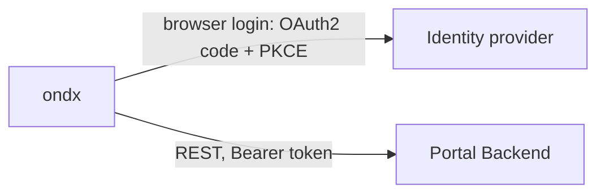

# ondx CLI

The OpenNDX command-line tool for operators. It logs you in through your browser and manages members, schemas, applications and access policy through the [Portal Backend](https://github.com/openndx/openndx-core/blob/main/cmd/pb/README.md) API.

## Overview



`ondx` talks to two systems only: the identity provider, for login, and the Portal Backend. It does not call the Orchestration Engine, Policy Decision Point or Consent Engine directly; the Portal Backend updates the policy service for you. It works with any OIDC identity provider the Portal Backend trusts. The built-in `local` profile targets the ThunderID instance in the repository's Docker Compose stack.

After `ondx login` the token is cached in `~/.openndx/` and refreshed automatically, so you log in again only when the refresh token expires.

## Install

```bash
brew install openndx/tap/ondx
# or
curl -fsSL https://raw.githubusercontent.com/openndx/openndx-core/main/scripts/install.sh | sh
# or, on Windows (PowerShell)
irm https://raw.githubusercontent.com/openndx/openndx-core/main/scripts/install.ps1 | iex
# or
go install github.com/openndx/openndx-core/cmd/ondx@latest
```

Prebuilt binaries and checksums for every OS and CPU are attached to each [GitHub Release](https://github.com/openndx/openndx-core/releases); the [tutorial](https://github.com/openndx/openndx-core/blob/main/docs/TUTORIAL-ondx-cli.md#1-install) covers every install option, including verifying a download with `gh attestation verify`. From a checkout, use `go build -o ondx ./cmd/ondx`. `ondx version` shows which build you have.

> **Version note.** Commands marked **†** below, and `profile set --resource`, are newer than release v0.4.0. Use a later release, or build from source, to get them.

## Quick start

```bash
ondx login          # opens your browser; the built-in local profile needs no flags
ondx members list
```

For a complete first run against a local stack, including providers, a consumer application, policy and citizen consent, follow the [end-to-end walkthrough](https://github.com/openndx/openndx-core/blob/main/dev/WALKTHROUGH.md).

## Commands

Every Portal Backend route checks an OAuth2 scope (see [authorization](https://github.com/openndx/openndx-core/blob/main/cmd/pb/AUTHORIZATION.md)). The login must request the scopes a command needs; the `local` profile requests all of them, and the identity provider grants only those your roles hold. Where a command shows a second scope, it is needed to act on other members' records and not only your own.

| Command | Purpose | Scope | `--json` |
|---|---|---|---|
| `ondx login` | Browser login; caches a token | none | |
| `ondx profile list`, `use <name>`, `set <name>` | Manage named profiles | none | |
| `ondx members create` | Register a member organization | `member:write-all` | |
| `ondx members list` **†** | List members | `member:read` (+ `member:read-all` for all) | yes |
| `ondx members get` **†** | Show one member | `member:read` (+ `member:read-all`) | yes |
| `ondx schemas create` | Register a schema and its fields | `schema:write` (+ `schema:write-all`) | |
| `ondx schemas list` **†** | List schemas | `schema:read` (+ `schema:read-all`) | yes |
| `ondx schemas get` **†** | Show a schema and its fields | `schema:read` (+ `schema:read-all`) | yes |
| `ondx applications create` | Register an application and its client | `application:write` (+ `application:write-all`) | |
| `ondx applications list`, `get` | List or show applications | `application:read` (+ `application:read-all`) | yes |
| `ondx policy update` | Replace an application's granted fields | `application:write` (+ `application:write-all`) | |
| `ondx version` | Print version and build info | none | |

Every command that logs in or calls the Portal Backend also accepts `--profile`, and those that call the Portal Backend accept `--pb-url`, `--credentials-path` and `--insecure` (see [Configuration](#configuration)). Run `ondx <command> -h` for the flags of one command.

### `ondx login`

| Flag | Env var | Meaning |
|---|---|---|
| `--issuer` | `NDX_ISSUER` | Identity provider base URL. The authorization and token endpoints are discovered from `{issuer}/.well-known/openid-configuration`. |
| `--auth-url`, `--token-url` | `NDX_AUTH_URL`, `NDX_TOKEN_URL` | Explicit endpoints; override discovery. Needed only if the provider does not serve that document. |
| `--client-id` | `NDX_CLIENT_ID` | OAuth2 public client ID (required). |
| `--scopes` | `NDX_SCOPES` | Space-separated scopes. Must include the Portal Backend scopes your commands need. |
| `--extra key=value` | | Extra authorization and token parameter, repeatable, for example `resource=...`. Saved with the token and reused on refresh. |
| `--callback-port` | | Fixed local port for the redirect. `0` means a random port. See [Callback port](#callback-port). |
| `--no-browser` | | Print the login URL instead of opening a browser. |

### `ondx members`

- `create`: `--name` and `--ou-id` are required. `--ou-id` is the ID of the member's organization unit in the identity provider, which must exist first; it is unique and cannot be changed. Optional `--email` and `--phone` are organization contact details. Nothing is created in the identity provider.
- `list` **†**: `--ou-id` filters to one organization unit's member. Without `member:read-all` you see only your own.
- `get` **†**: `--member-id` (required).

### `ondx schemas`

- `create`: requires `--name`, `--endpoint` (the provider's GraphQL URL), `--member-id` and at least one `--field fieldName:accessControlType:source[:isOwner]`. `accessControlType` is `public` or `restricted`; `source` is `primary` or `fallback`; add `:isOwner` for the field that identifies the record's owner. Optional `--schema-id` (3 to 64 lowercase letters, digits, `.`, `_` or `-`; defaults to a generated UUID; cannot change later; a taken ID fails with `409`) and `--description`. Use the ID that the Orchestration Engine's `@sourceInfo(schemaId: ...)` names. Prints each field as `schemaId:fieldName`, the form `applications create` expects.
- `list` **†**: `--member-id` filters to one member.
- `get` **†**: `--schema-id` (required). Prints the fields as `schemaId:fieldName`.

### `ondx applications`

- `create`: requires `--name`, `--member-id` and at least one `--field schemaId:fieldName`. The Portal Backend creates the application's OAuth2 client in the member's organization unit and prints its client secret **once**. To register a client you already created, pass `--idp-application-id` and `--idp-client-id` together. Optional `--description`. A field must already exist in a registered schema, or the command fails with "policy metadata not found".
- `list`: `--member-id` filters to one member.
- `get`: `--app-id` (required). Shows the saved policy as `schemaId:fieldName` values.

### `ondx policy update`

`--app-id` and one or more `--field schemaId:fieldName`, optionally `--grant-duration 30d` or `365d`. Pass every field the saved policy should contain, including ones it already has: the Portal Backend replaces its stored list. Leaving a field out does not currently revoke its existing grant in the Policy Decision Point.

## Configuration

**Precedence** for a setting: command-line flag, then its `NDX_*` environment variable, then the selected profile. The profile is the one named by `--profile` or `NDX_PROFILE`, otherwise the current profile.

| Environment variable | Used by |
|---|---|
| `NDX_PROFILE` | every command: which profile to use |
| `NDX_ISSUER`, `NDX_AUTH_URL`, `NDX_TOKEN_URL`, `NDX_CLIENT_ID`, `NDX_SCOPES` | `login` |
| `NDX_PB_URL` | every command that calls the Portal Backend |

Callback port, `--insecure`, `--extra` and the profile's `resource` have no environment variable.

**Profiles** are stored in `~/.openndx/config.json`. A built-in `local` profile always exists:

| Setting | `local` value |
|---|---|
| Issuer | `http://localhost:8090` (ThunderID) |
| Client ID, callback port | `NDX_CLI`, `8765` |
| Resource | `http://pb.openndx.local` |
| Portal Backend URL | `http://localhost:8083` |
| Scopes | `openid roles email` and every Portal Backend scope |

`ondx profile set <name>` creates or updates a profile and changes only the flags you pass: `--issuer`, `--auth-url`, `--token-url`, `--client-id`, `--scopes`, `--callback-port`, `--resource`, `--pb-url`, `--insecure`. Each non-`local` profile has its own token cache, `~/.openndx/credentials-<name>.json`, so switching profiles never reuses another provider's token.

```bash
ondx profile set staging --issuer https://idp.staging.example.com --client-id ondx-cli-staging \
  --resource https://pb.staging.example.com --pb-url https://pb.staging.example.com
ondx profile use staging     # default for later commands
ondx profile list            # * marks the current profile
ondx login --profile local   # one-off use of another profile
```

## Notes

### Callback port

`ondx login` starts a short-lived local server on `127.0.0.1` to receive the redirect. By default it uses a random port. A provider that registers an exact redirect URI needs a fixed `--callback-port`. ThunderID's `NDX_CLI` client is registered for `http://127.0.0.1:8765/callback`, so with `--client-id NDX_CLI` the CLI rejects any other port, including the random default, rather than attempt a login ThunderID would refuse.

### Resource binding

ThunderID sets a token's `aud` to the resource requested with `resource=`, and the Portal Backend accepts only tokens for its own audience. The login therefore has to request it. The `local` profile does; for another environment set it once with `ondx profile set <name> --resource <pb-audience>`, or pass `--extra resource=...` for one login. A token for the wrong audience gets `401`. If a `local` profile was saved before it had a `resource`, run `ondx profile set local --resource http://pb.openndx.local` and log in again.

### TLS and `--insecure`

The local ThunderID serves plain HTTP, so `--insecure` has no effect there. It skips certificate verification for HTTPS endpoints with untrusted certificates. Use it only for local or test setups.

## Limitations

- An application's client secret is shown once, in the `applications create` output. It cannot be retrieved again.
- Organization units and their users must already exist in the identity provider. The local stack seeds `drp` (`01900000-0000-7000-8000-0000000000c0`) and `die` (`01900000-0000-7000-8000-0000000000c1`), with users `drp-admin` and `die-admin` who hold the `OpenNDX_Member` role.
- There are no update or delete commands, and the CLI does not manage schema policy metadata beyond `schemas create`.
- Applications created by approving an application submission in the portals do not surface their client secret.

## More docs

- [End-to-end walkthrough](https://github.com/openndx/openndx-core/blob/main/dev/WALKTHROUGH.md)
- [CLI tutorial](https://github.com/openndx/openndx-core/blob/main/docs/TUTORIAL-ondx-cli.md)
- [Portal Backend](https://github.com/openndx/openndx-core/blob/main/cmd/pb/README.md) and its [authorization model](https://github.com/openndx/openndx-core/blob/main/cmd/pb/AUTHORIZATION.md)
