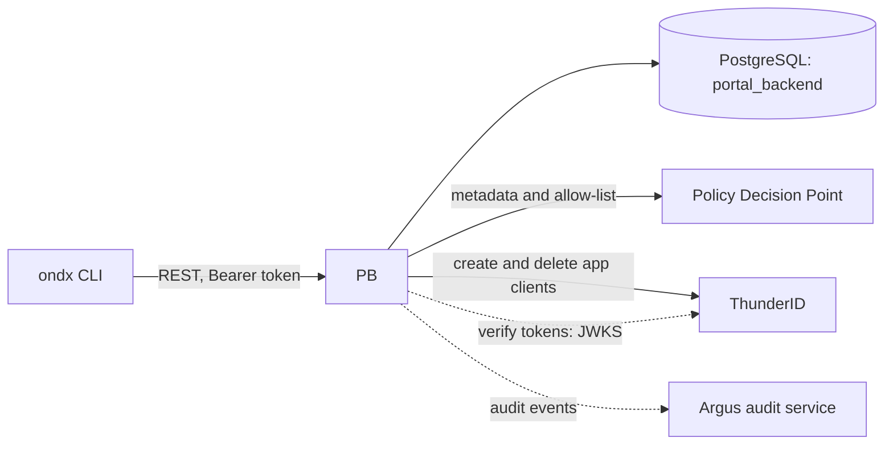
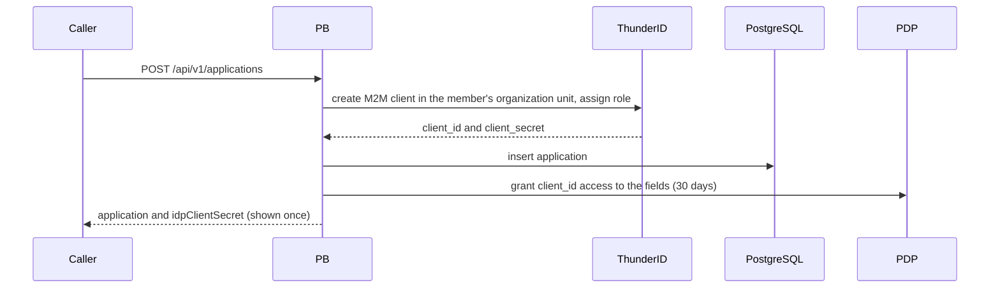

# Portal Backend (PB)

The management REST API of OpenNDX: members, provider schemas, consumer applications, and the submissions that create them. It validates callers' tokens, enforces scope-based access, and keeps the Policy Decision Point and the identity provider in step with what it stores.

> **Naming.** PB is planned to be renamed **Management Server**. Until then the code, image, service and environment names all say `portal-backend` or `pb`; the [rename checklist](#rename-note) lists every place the name appears.

## Overview



PB remains an actively maintained management API, used through the [`ondx` CLI](../ondx/README.md) or direct authenticated API calls. The [Admin and Member Portals](../../portals/README.md) are paused, unsupported prototypes and do not provide a supported management interface. The Consent Portal does not use it. PB never calls the Orchestration Engine or Consent Engine.

## Quick start

With Docker Compose (from the repo root). PB needs the PDP at runtime, so start both:

```bash
docker compose up --build portal-backend policy-decision-point
curl http://localhost:8083/health
```

This also starts PostgreSQL and ThunderID, and registers PB's own client (`PORTAL_BACKEND`) in ThunderID.

Native, against your own PostgreSQL, PDP and identity provider. The service does not create tables, so load the schema into an empty `portal_backend` database first:

```bash
PGPASSWORD=<password> psql -h localhost -U postgres -d portal_backend \
  -v ON_ERROR_STOP=1 -f cmd/pb/schema.sql

cp cmd/pb/config.example.yaml cmd/pb/config.yaml    # once; config.yaml is git-ignored
export DB_PASSWORD=<password> IDP_CLIENT_SECRET=<secret>
make run portal-backend    # or: go run ./cmd/pb -config cmd/pb/config.yaml
```

[config.example.yaml](config.example.yaml) points at `localhost:5432` as user `postgres`, a PDP on `localhost:8082` and a ThunderID on `localhost:8090`, and reads the two secrets from the environment. Schema changes go directly into [schema.sql](schema.sql); there is no versioned upgrade path.

## Configuration

PB reads one YAML file: the `-config` flag, else `CONFIG_PATH`, else `config.yaml` in the working directory. There are no other flags or environment variables. The Docker image sets `CONFIG_PATH=/app/config/config.yaml` and has no config file of its own, so mount one there. Compose mounts [config.docker.yaml](config.docker.yaml).

A value written as `"{{env:NAME}}"` or `"{{file:/path}}"` is read from that environment variable or file at startup, so secrets stay out of the file. Required keys:

| Key | Notes |
|---|---|
| `idp.jwksURL`, `idp.issuer`, `idp.audience` | Validate incoming tokens. `audience` is PB's resource-server identifier. |
| `idp.management.baseURL`, `.clientID`, `.clientSecret` | PB's own client for ThunderID's management API. |
| `pdp.url` | Policy Decision Point. |
| `database.postgres.host`, `.user`, `.password` | |

Every key, its default and the environment variable it replaces: [CONFIGURATION.md](CONFIGURATION.md).

## API

All routes are under `/api/v1` and need `Authorization: Bearer <token>`. Full schemas: [openapi.yaml](openapi.yaml). Success responses are the bare resource, lists are `{items, count}`, and errors are `{"error": "<message>"}`.

| Resource | Endpoints | Scope |
|---|---|---|
| Members | `GET /members`, `GET /members/{memberId}`<br>`POST /members`<br>`PUT /members/{memberId}` | `member:read`<br>`member:write-all`<br>`member:write` |
| Schemas | `GET /schemas`, `GET /schemas/{schemaId}`<br>`POST /schemas`, `PUT /schemas/{schemaId}` | `schema:read`<br>`schema:write` |
| Schema policy metadata | `GET /schemas/{schemaId}/policy-metadata`<br>`PATCH`, `DELETE` on `.../policy-metadata/{id}`<br>`DELETE .../policy-metadata/{id}/allowlist/{applicationId}` | `schema:read`<br>`schema:write` |
| Schema submissions | `GET /schema-submissions`, `GET .../{submissionId}`<br>`POST /schema-submissions`, `PUT .../{submissionId}` | `schema-submission:read`<br>`schema-submission:write` |
| Applications | `GET /applications`, `GET /applications/{applicationId}`<br>`POST /applications`, `PUT /applications/{applicationId}`<br>`PUT /applications/{applicationId}/policy` | `application:read`<br>`application:write` |
| Application submissions | `GET /application-submissions`, `GET .../{submissionId}`<br>`POST /application-submissions`, `PUT .../{submissionId}` | `application-submission:read`<br>`application-submission:write` |

Outside `/api/v1`, with no authentication: `GET /health` (`503` if the database is down), `GET /debug` and `GET /debug/db`. The authorization model, including the `-all` scopes and what each ThunderID role may do, is in [AUTHORIZATION.md](AUTHORIZATION.md).

## How it works

Creating an application touches three systems, so PB undoes earlier steps if a later one fails:



- PDP access grants are keyed by the IdP `client_id`, which is the identity the Orchestration Engine reads from consumer tokens. The `allowList` in policy metadata responses lists the applications with an active grant.
- `POST /schemas` stores the schema, then registers its policy metadata in the PDP, and removes the schema if that fails.
- A submission is a request that becomes a schema or application when its status is set to `approved` (`PUT .../{submissionId}`); the creation steps above then run, and the status goes back to `pending` if they fail. Who may set that status is described in [AUTHORIZATION.md](AUTHORIZATION.md#submission-approval).
- A caller reaches its own member's records. Reaching other members' records needs the matching `-all` scope as well.

## Security and deployment

> **Deployment security: network isolation.** `/health`, `/debug` and `/debug/db` are not authenticated. Expose only `/api/v1/*` beyond the internal network. PB also calls the PDP without authentication, so the PDP must be reachable only from PB and the Orchestration Engine.

- CORS defaults to `http://localhost:5173`. Compose sets `*`; set explicit origins for any shared deployment.
- PB serves no `/metrics` endpoint and no `/openapi.yaml`; the spec is the file in this directory.

## Development

```bash
make validate-test portal-backend      # tests with -race and coverage
go test ./cmd/pb/... ./internal/pb/... -count=1
make quality-check portal-backend
```

Tests run without external services. `make validate-test` does not cover `internal/authn`; run `go test ./internal/authn/...` for the token validation code. Docker image: `docker build -t portal-backend -f cmd/pb/Dockerfile .` from the repo root.

Code is in [`internal/pb`](../../internal/pb): `member`, `schema` and `application` (one package per resource: model, service, handler), `caller` (scopes and the caller's member), `policy` (PDP client), `idp/thunderid` (ThunderID client), `middleware` (audit), `database/dbtest` (test databases). The configuration is in [`config.go`](config.go). PB connects through the shared [`internal/database`](../../internal/database), which uses `OpenNSW/core/database`; CORS is [`OpenNSW/core/cors`](https://github.com/OpenNSW/core/tree/main/cors). Token validation is in [`internal/authn`](../../internal/authn/README.md).

## Rename note

When PB becomes Management Server, these identifiers embed the current name:

- Compose service, container and image: `portal-backend`, `pb-${ENVIRONMENT}`, `ghcr.io/openndx/portal-backend`; Makefile service name and CI workflows (`portal-backend-validate`, `portal-backend-publish`)
- Go packages `internal/pb` and `internal/cli/pbclient`; the `"portal-backend"` string in `/health` and `/debug`
- Environment variables `PB_PORT`, `DB_NAME_PB`, `PB_AUDIENCE`, and the `ondx` flag and variable `--pb-url` / `NDX_PB_URL`
- The token audience `http://pb.openndx.local`, which clients request as `resource=`
- ThunderID seed data in `thunderid/bootstrap`: the `PORTAL_BACKEND` client, the `PortalBackendSystem` role and the "Portal Backend Resource Server"

## More docs

- [AUTHORIZATION.md](AUTHORIZATION.md): scopes, ownership rules, roles, submission approval
- [CONFIGURATION.md](CONFIGURATION.md): every configuration key
- [openapi.yaml](openapi.yaml): API reference
- [`ondx` CLI](../ondx/README.md) and [Policy Decision Point](../pdp/README.md)
