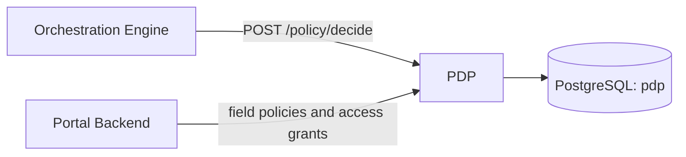

# Policy Decision Point (PDP)

Stores field policies and per-application access grants, and answers one question for the Orchestration Engine: *may this application read these fields, and does the data owner need to consent?*

## Overview

The PDP is a leaf service. It calls nothing else and stores everything in its own PostgreSQL database (`pdp`).



| Caller | Uses |
|---|---|
| Orchestration Engine | `POST /api/v1/policy/decide` before every federated query |
| Portal Backend | field policy and access grant endpoints, when schemas and applications are approved or edited |

Each field's `field_policies` record has two flags, `requiresAllowlist` and `requiresConsent`. The decision comes from those flags and the application's grant in `access_grants` (see [POLICY_MODEL.md](POLICY_MODEL.md)).

## Quick start

With Docker Compose (from the repo root; starts PostgreSQL first):

```bash
docker compose up --build policy-decision-point
curl http://localhost:8082/health
```

Natively, with its dependencies in Docker (see [running the platform](../../docs/contributing/development.md#running-the-platform)):

```bash
make deps                                             # PostgreSQL with schema.sql loaded, and the rest
cp cmd/pdp/config.example.yaml cmd/pdp/config.yaml    # once; config.yaml is git-ignored
export DB_PASSWORD=1234                               # the Compose default
make dev SVC=pdp
```

The Orchestration Engine and Portal Backend containers call the PDP, so to use them with a native PDP, run them natively too (`make dev`). [config.example.yaml](config.example.yaml) points at `localhost:5432` as user `postgres` and reads the password from `DB_PASSWORD`. The service does not create tables; Compose's PostgreSQL loads [schema.sql](schema.sql) on a fresh database. Schema changes go directly into `schema.sql`; there is no versioned upgrade path.

## Configuration

The PDP reads one YAML file: the `-config` flag, else `CONFIG_PATH`, else `config.yaml` in the working directory. There are no other flags or environment variables. The Docker image sets `CONFIG_PATH=/app/config/config.yaml` and has no config file of its own, so mount one there. Compose mounts [config.docker.yaml](config.docker.yaml).

A value written as `"{{env:NAME}}"` or `"{{file:/path}}"` is read from that environment variable or file at startup, so secrets stay out of the file. The placeholder must be the whole value, and an unset or empty variable stops the service.

| Key | Default | Notes |
|---|---|---|
| `server.port` | `8082` | Listen port. The server binds on all interfaces. |
| `server.timeout` | `10s` | Read and write timeout. |
| `environment` | none | Deployment name (for example `local`, `staging`), added to every log line. Left out of log lines when empty. |
| `logging.level` | `info` | `debug`, `info`, `warn` or `error`. |
| `logging.format` | `json` | `json` or `text`. Every line carries `service`, `version` and, when set, `environment`. |
| `database.driver` | `postgres` | Only `postgres` is supported. |
| `database.postgres.host`, `.user`, `.password` | none | **Required.** |
| `database.postgres.port` | `5432` | |
| `database.postgres.name` | `pdp` | |
| `database.postgres.sslMode` | `require` | Use `disable` for a local PostgreSQL without TLS. |
| `database.postgres.pool.maxOpenConns`, `.maxIdleConns`, `.maxConnLifetimeSeconds` | `25`, `5`, `3600` | Connection pool. |
| `database.idleTimeout` | `30m` | Closes connections idle this long. |

The service checks the file at startup and exits with an error naming the bad key. Keys it does not know are ignored, so check the spelling of any key that seems to have no effect.

## API

Full request and response schemas: [openapi.yaml](openapi.yaml). Success bodies are the bare resource and errors are `{"error": "<message>"}`.

| Method and path                                                 | Purpose                                                            |
|-----------------------------------------------------------------|--------------------------------------------------------------------|
| `POST /api/v1/policy/decide`                                    | Authorization decision for an application and a list of fields     |
| `GET /api/v1/policy/fields?schemaId=`                           | List field policies, optionally for one schema                     |
| `POST /api/v1/policy/fields`                                    | Sync a schema's field policies (`201`)                             |
| `PATCH /api/v1/policy/fields/{id}`                              | Edit `displayName`, `description`, `requiresAllowlist` or `requiresConsent` |
| `DELETE /api/v1/policy/fields/{id}`                             | Delete a field policy and its grants (`204`)                       |
| `GET /api/v1/policy/grants?applicationId=&schemaId=&status=&consentBypass=` | List access grants, optionally filtered                |
| `POST /api/v1/policy/grants`                                    | Grant an application access to fields for `30d` or `365d`; with `consentBypass` and `legalBasis`, a consent bypass |
| `GET /api/v1/policy/grants/{id}`                                | Read one grant                                                     |
| `POST /api/v1/policy/grants/{id}/revoke`                        | Revoke one grant; it is kept with status `revoked`                 |
| `GET /health`                                                   | `{"service": "policy-decision-point", "status": "healthy"}`        |

A decision request and response:

```json
{ "applicationId": "passport-app",
  "requiredFields": [{ "schemaId": "drp-v1", "fieldName": "person.fullName" }] }
```

```json
{ "fields": [{ "schemaId": "drp-v1", "fieldName": "person.fullName", "outcome": "allow" }],
  "appAuthorized": true, "unauthorizedFields": [],
  "appAccessExpired": false, "expiredFields": [],
  "appRequiresOwnerConsent": false, "consentRequiredFields": [] }
```

`applicationId` is the OIDC `client_id` of the calling application. Field policy and grant requests use camelCase keys; see the schemas in `openapi.yaml`.

## How it works

For each requested `(schemaId, fieldName)`, in order:

1. No field policy: the whole request fails with **HTTP 500**.
2. No application ID: the field is *unauthorized*.
3. The field requires the allow-list and the application holds no active grant for it: the field is *unauthorized*.
4. The field requires the allow-list and the grant has expired: the field is *expired*.
5. The field requires consent: it needs owner consent, unless the application holds an unexpired consent bypass grant, which allows it.
6. Otherwise the field is allowed.

`appAuthorized` is true when no field is unauthorized. A field allowed through a consent bypass carries the `audit.consent_bypassed` obligation, which the Orchestration Engine records in its audit event. Field semantics, the consent bypass workflow and the table schema are in [POLICY_MODEL.md](POLICY_MODEL.md).

## Security and deployment

> **Deployment security: network isolation.** No PDP route is authenticated. Anyone who can reach port 8082 can read and rewrite policy. Expose it only on the internal network, reachable by the Orchestration Engine and Portal Backend.

## Development

```bash
make test PKG="./cmd/pdp/... ./internal/pdp/..."    # tests with -race
make check                                          # tidy, lint and test the whole module
```

Tests use an in-memory SQLite database, so no PostgreSQL is needed. The configuration is in [`config.go`](config.go). Code is in [`internal/pdp`](../../internal/pdp), one package per concern, each with its service and handler: `fieldpolicy` (field policies), `grant` (access grants) and `decision` (decisions, reading fields and grants through interfaces it declares); `pdptest` holds test helpers.

## More docs

- [POLICY_MODEL.md](POLICY_MODEL.md): field semantics, decision rules, table schema
- [openapi.yaml](openapi.yaml): API reference
- [Orchestration Engine](../oe/README.md) and [Portal Backend](../pb/README.md): the two callers
