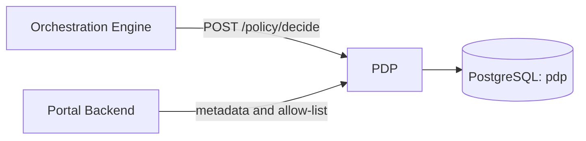

# Policy Decision Point (PDP)

Stores field-level policy metadata and per-application allow-lists, and answers one question for the Orchestration Engine: *may this application read these fields, and does the data owner need to consent?*

## Overview

The PDP is a leaf service. It calls nothing else and stores everything in its own PostgreSQL database (`pdp`).



| Caller | Uses |
|---|---|
| Orchestration Engine | `POST /api/v1/policy/decide` before every federated query |
| Portal Backend | metadata and allow-list endpoints, when schemas and applications are approved or edited |

There is no policy language or rules engine. The decision is a lookup over the `policy_metadata` table (see [POLICY_MODEL.md](POLICY_MODEL.md)).

## Quick start

With Docker Compose (from the repo root; starts PostgreSQL first):

```bash
docker compose up --build policy-decision-point
curl http://localhost:8082/health
```

Native, against a PostgreSQL that already has an empty `pdp` database:

```bash
export DB_HOST=localhost DB_PORT=5432 DB_USERNAME=postgres DB_PASSWORD=<password> \
       DB_NAME=pdp DB_SSLMODE=disable RUN_MIGRATION=true
go run ./cmd/pdp        # or: make run policy-decision-point
```

`RUN_MIGRATION=true` is required on the first start. It creates the enum types and the `policy_metadata` table. Without it a fresh database has no table.

No binary loads a `.env` file. Export the variables, or pass `--env-file` to Docker. [.env.example](.env.example) is a template.

## Configuration

| Variable | Default | Notes |
|---|---|---|
| `PORT` | `8082` | Listen port. The server binds on all interfaces. |
| `ENVIRONMENT` | `local` | `production` switches the default log level to `warn`. |
| `DB_HOST` / `DB_PORT` | `localhost` / `5432` | |
| `DB_USERNAME` / `DB_PASSWORD` | `postgres` / empty | |
| `DB_NAME` | `pdp` | |
| `DB_SSLMODE` | `require` | Use `disable` for a local PostgreSQL without TLS. |
| `RUN_MIGRATION` | unset | Migrations run only when the value is exactly `true`. |
| `IDP_ISSUER`, `IDP_AUDIENCE`, `IDP_JWKS_URL` | ThunderID dev values | Read and logged only. The PDP does not validate tokens. |

Command-line flags: `-env`, `-port`, `-timeout` (default `10s`), `-log-level`, `-log-format`. There is no `LOG_LEVEL` variable. `-host`, `-cors` and `-rate-limit` are accepted but have no effect.

Compose values (database `pdp`, `DB_SSLMODE=disable`, `RUN_MIGRATION=true`) are in [compose.yml](../../compose.yml).

## API

Full request and response schemas: [openapi.yaml](openapi.yaml). Success bodies are the bare resource and errors are `{"error": "<message>"}`.

| Method and path | Purpose |
|---|---|
| `POST /api/v1/policy/decide` | Authorization decision for an application and a list of fields |
| `GET /api/v1/policy/metadata?schemaId=` | List metadata records, optionally for one schema |
| `POST /api/v1/policy/metadata` | Sync a schema's field metadata (`201`) |
| `PATCH /api/v1/policy/metadata/{id}` | Edit `displayName`, `description` or `accessControlType` |
| `DELETE /api/v1/policy/metadata/{id}` | Delete a record (`204`) |
| `DELETE /api/v1/policy/metadata/{id}/allowlist/{applicationId}` | Revoke one application's access to one field (`204`) |
| `POST /api/v1/policy/update-allowlist` | Grant an application access to fields for `30d` or `365d` |
| `GET /health` | `{"service": "policy-decision-point", "status": "healthy"}` |
| `GET /debug`, `GET /debug/db` | Version info; database status and record count |

A decision request and response:

```json
{ "applicationId": "passport-app",
  "requiredFields": [{ "schemaId": "drp-v1", "fieldName": "person.fullName" }] }
```

```json
{ "appAuthorized": true, "unauthorizedFields": [],
  "appAccessExpired": false, "expiredFields": [],
  "appRequiresOwnerConsent": false, "consentRequiredFields": [] }
```

`applicationId` is the OIDC `client_id` of the calling application. Metadata and allow-list requests use camelCase keys; see the schemas in `openapi.yaml`.

## How it works

For each requested `(schemaId, fieldName)`, in order:

1. No metadata record: the whole request fails with **HTTP 500**.
2. The application is not in the field's allow-list: the field is *unauthorized*.
3. The allow-list entry has expired: the field is *expired*.
4. Otherwise the field needs owner consent if it is `restricted` and the caller is not the field's owner (`isOwner: false`).

`appAuthorized` is true when no field is unauthorized. A `public` field still needs an allow-list entry. Field semantics and the table schema are in [POLICY_MODEL.md](POLICY_MODEL.md).

## Security and deployment

> **Deployment security: network isolation.** No PDP route is authenticated. Anyone who can reach port 8082 can read and rewrite policy. Expose it only on the internal network, reachable by the Orchestration Engine and Portal Backend.

## Development

```bash
make validate-test policy-decision-point    # tests with -race and coverage
go test ./cmd/pdp/... ./internal/pdp/... -count=1
make quality-check policy-decision-point    # format, vet, lint, security
```

Tests use an in-memory SQLite database, so no PostgreSQL is needed. Code is in [`internal/pdp`](../../internal/pdp): `handler` (HTTP), `services` (decision and metadata logic), `models`, `db`, `config`.

## More docs

- [POLICY_MODEL.md](POLICY_MODEL.md): field semantics, decision rules, table schema
- [openapi.yaml](openapi.yaml): API reference
- [Orchestration Engine](../oe/README.md) and [Portal Backend](../pb/README.md): the two callers
