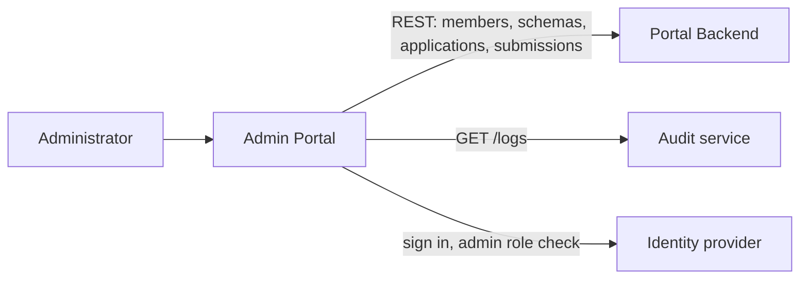

# Admin Portal

The web app for OpenNDX operators. Administrators register and edit member organizations, review the schemas and applications that members submit, and browse the audit log.

> **Status: not yet adapted to the current Portal Backend.** The pages and flows below are what the code does, but its API and sign-in code predate the Portal Backend's bearer-token and scope checks and the move to organization-unit members, so it does not work against the current stack. [Status and known gaps](#status-and-known-gaps) lists what to change. This portal is not in the Docker Compose stack.

## Overview



Stack: React 19, TypeScript, Vite, Tailwind, `@asgardeo/auth-react`. Only users whose identity-provider roles include `VITE_IDP_ADMIN_ROLE` can use it; others see an error after sign-in. The members' side of the review workflow is the [Member Portal](../member/README.md).

## Quick start

From `portals/` (Node 24+, pnpm; see [portals/README.md](../../README.md)):

```bash
pnpm install
# create apps/admin/public/config.js, see Configuration, then:
pnpm --filter admin-portal run dev        # http://localhost:5173
```

The admin and member portals both default to port 5173. Run them one at a time or set `VITE_PORT` (below).

## Configuration

Two layers:

- **Build time** (read by Vite from `.env`): `VITE_PORT` (default `5173`) and `VITE_BASE_PATH` (default `/`).
- **Runtime**, from `window.configs`, filled from `config.js` (loaded by `index.html`). `.env` does **not** populate it. Locally, create `apps/admin/public/config.js` (git-ignored); in Docker the container writes it at startup from environment variables of the same names.

| Key (also the Docker environment variable) | Meaning |
|---|---|
| `VITE_API_URL` | Portal Backend base URL. The code appends `/members`, `/schemas` and so on, so it must end in `/api/v1`. |
| `VITE_LOGS_URL` | Audit service base URL, for the log viewer. |
| `VITE_IDP_CLIENT_ID` | OAuth2 client ID. |
| `VITE_IDP_BASE_URL` | Identity provider base URL. |
| `VITE_IDP_SCOPE` | **Comma-separated** scopes. Default `openid,profile`. |
| `VITE_IDP_ADMIN_ROLE` | Role a user needs to enter the portal. |
| `VITE_SIGN_IN_REDIRECT_URL`, `VITE_SIGN_OUT_REDIRECT_URL` | OIDC redirect URLs. |

```js
// apps/admin/public/config.js
window.configs = {
  VITE_API_URL: 'http://localhost:8083/api/v1',
  VITE_LOGS_URL: 'http://localhost:3001',
  VITE_IDP_CLIENT_ID: '<client id>',
  VITE_IDP_BASE_URL: 'http://localhost:8090',
  VITE_IDP_SCOPE: 'openid,profile,<the 20 Portal Backend scopes listed in .env.example>',
  VITE_IDP_ADMIN_ROLE: 'admin',
  VITE_SIGN_IN_REDIRECT_URL: 'http://localhost:5173',
  VITE_SIGN_OUT_REDIRECT_URL: 'http://localhost:5173',
};
```

[.env.example](.env.example) has the complete scope list. The other portals name these keys differently; the three conventions are compared in [portals/README.md](../../README.md#configuration).

## What it calls

| Backend | Calls |
|---|---|
| Portal Backend (`VITE_API_URL`) | `GET`, `POST /members` and `PUT /members/{id}`; `GET /schemas`, `GET /schema-submissions?status=pending&status=rejected`, `PUT /schema-submissions/{id}`; the same three for applications |
| Audit service (`VITE_LOGS_URL`) | `GET /logs` with filters, and `GET /logs/export?format=csv` |

## How it works

| Route | What it does |
|---|---|
| `/` | A placeholder home page. |
| `/members` | List and search members by name; create one (name, email, phone); edit a member's name and phone. |
| `/schemas` | Review pending and rejected schema submissions: approve or reject with a review comment. Also lists the approved schemas. |
| `/applications` | The same review flow for application submissions, and the approved applications. |
| `/logs` | Audit log viewer with filters and CSV export. |

Approving a submission sets its status to `approved` through the Portal Backend, which then creates the schema or application (see [PB authorization](../../../cmd/pb/AUTHORIZATION.md#submission-approval)). There is no way to delete a member, and no health or settings page.

## Status and known gaps

Verified in the code, against the current [Portal Backend](../../../cmd/pb/README.md):

- **No bearer token.** No request to the Portal Backend or the audit service carries an `Authorization` header, but every Portal Backend `/api/v1` route requires one and a scope.
- **Wrong base path.** The Portal Backend serves only under `/api/v1`, while the code appends paths directly to `VITE_API_URL`.
- **Member creation.** The form sends name, email and phone. The Portal Backend requires an `ouId` (the member's identity-provider organization unit) and the `member:write-all` scope. The member list still reads the removed `idpUserId` field.
- **Sign-in.** The Asgardeo SDK is given hard-coded Asgardeo tenant endpoints in `src/main.tsx`, so `VITE_IDP_BASE_URL` does not choose the identity provider. The bundled ThunderID has no client registered for this portal.
- **Admin role.** The check compares the user's `roles` with `VITE_IDP_ADMIN_ROLE` (default `admin`). In the bundled ThunderID the administrator role is `OpenNDX_Admin`, and the Portal Backend itself checks scopes, not role names.
- **Docker image.** The nginx content-security policy has no `connect-src`, so the browser is likely to block calls to the Portal Backend and identity provider from the container.
- **Audit endpoints.** The log viewer calls `/logs` and `/logs/export`, which has not been checked against the audit service version in Compose.

## Development

From `portals/`:

```bash
pnpm --filter admin-portal run build      # type-check and production build
pnpm --filter admin-portal run lint
```

There is no test script. From the repo root, `make run admin-portal`, `make validate-build admin-portal` and `make check-lint admin-portal` wrap these. To build the image, use `portals/` as the context: `docker build -t admin-portal -f apps/admin/Dockerfile .` from `portals/`; run it with the variables above and `-p 5173:80`.

Source is in [`src`](src): `pages`, `services` (API calls), `components`, `types`.

## More docs

- [portals/README.md](../../README.md): workspace, config conventions
- [Member Portal](../member/README.md): submits what this portal reviews
- [Portal Backend](../../../cmd/pb/README.md) and its [authorization model](../../../cmd/pb/AUTHORIZATION.md)
