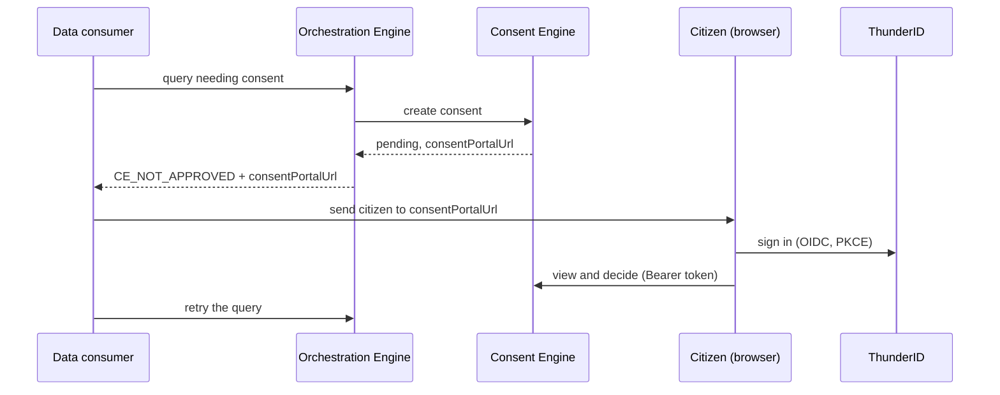

# Consent Portal

The citizen-facing web app where data owners approve, reject or revoke requests to use their data. It is the only portal in the Docker Compose stack.

## Overview



The portal talks only to the [Consent Engine](../../../cmd/ce/README.md) (portal API) and the identity provider. A citizen reaches it two ways:

- **From a request:** the consent link `<portal>/?consentId=<uuid>` that the Consent Engine issued and the consumer passes on.
- **Self-service:** `<portal>/consents`, for a citizen who signs in on their own (for example at a kiosk) to list their requests, decide pending ones, and revoke approved ones.

Stack: React 19, TypeScript, Vite, Tailwind, `react-oidc-context`.

## Quick start

With Docker Compose (from the repo root; also starts the Consent Engine and ThunderID):

```bash
docker compose up --build consent-portal
```

Open <http://localhost:5173>. The container serves the built app with nginx on port 80 (mapped to 5173) and answers `GET /health`.

For development, run from `portals/` (Node 24+, pnpm; see [portals/README.md](../../README.md)):

```bash
pnpm install
cp apps/consent/public/config.example.js apps/consent/public/config.js    # git-ignored; edit the values
pnpm --filter consent-portal run dev                                        # http://localhost:5173
```

To use another port: `pnpm --filter consent-portal run dev -- --port 5180`, and register that origin with the identity provider. The portal has no `VITE_PORT` or `VITE_BASE_PATH` setting.

## Configuration

The portal reads `window.configs`, filled in at **runtime** from `config.js` (loaded by `index.html`), so one build serves any environment. In Docker the container writes `config.js` at startup from environment variables.

| `window.configs` key | Docker environment variable | Meaning |
|---|---|---|
| `consentEngineUrl` | `CONSENT_ENGINE_URL` | Consent Engine API base **including** `/api/v1`, for example `http://localhost:8081/api/v1`. Called from the browser, so it must be reachable from the user's machine. |
| `idpBaseUrl` | `IDP_BASE_URL` | OIDC issuer URL. Endpoints come from `<idpBaseUrl>/.well-known/openid-configuration`. |
| `idpClientId` | `IDP_CLIENT_ID` | OAuth2 public client ID. |
| `idpScope` | `IDP_SCOPE` | Scopes to request. Default `openid profile email`. |
| `idpSignInRedirectUrl` | `IDP_SIGN_IN_REDIRECT_URL` | Where the identity provider returns after login. |
| `idpSignOutRedirectUrl` | `IDP_SIGN_OUT_REDIRECT_URL` | Where it returns after logout. |

All but `idpScope` are required; the app stops with an error naming the missing keys. Compose values (all pointing at `localhost`, because the browser fetches them) are in [compose.yml](../../../compose.yml).

## Backend API

Every call sends `Authorization: Bearer <access token>` to the Consent Engine:

| Call | Used for |
|---|---|
| `GET /consents?limit=&offset=[&status=pending]` | The list, with Pending and All tabs |
| `GET /consents/{consentId}` | The detail and decision page |
| `PUT /consents/{consentId}` with `{"action": "approve" \| "reject" \| "revoke"}` | Deciding, and revoking an approved consent |

A `401` shows a "session expired, sign in again" message, a `403` goes to an unauthorized page, and a `409` means the consent can no longer be changed. Routes: `/`, `/consents`, `/consents/:consentId`, `/login`, `/success`, `/error`, `/unauthorized`.

## How it works

- The `consentId` from the link is kept in `localStorage` across the sign-in redirect and removed after a decision.
- After a decision the portal shows a confirmation, tells the opening window (`postMessage("consentGranted")`), and tries to close itself. The Consent Engine returns no return URL, so there is no redirect back to the consumer; the consumer repeats its request.
- A consent is bound to the data owner: the token's subject claim must equal the consent's `ownerId`. Which claim that is, is set in the Consent Engine (`IDP_SUBJECT_CLAIM`). The bundled stack uses `nic`, so the access token must carry it. See [CONSENT_LIFECYCLE.md](../../../cmd/ce/CONSENT_LIFECYCLE.md#who-may-decide).

## Security and deployment

- **Identity provider client.** A public client with authorization-code and PKCE, and exact redirect URIs for the sign-in and sign-out URLs. In the bundled stack that is the ThunderID `CONSENT_PORTAL` client, which registers `<portal URL>` and `<portal URL>/callback` ([thunderid/bootstrap/application.yaml](../../../thunderid/bootstrap/application.yaml)). The same origin must be in ThunderID's CORS list ([cors.yaml](../../../thunderid/bootstrap/cors.yaml), currently `http://localhost:5173`).
- **Consent Engine.** It must allow the portal's origin (`CONSENT_PORTAL_URL` is always allowed) and check tokens against the same issuer. Its `IDP_AUDIENCE` and `IDP_CLIENT_ID` must match the token; Compose uses `CONSENT_PORTAL`.
- **Content security.** The nginx image allows connections to `self`, `http:` and `https:` origins, so the browser can reach the Consent Engine and the identity provider.

## Development

All from `portals/`:

```bash
pnpm --filter consent-portal run build     # type-check and production build
pnpm --filter consent-portal run lint
```

There is no test script. From the repo root, `make run consent-portal`, `make validate-build consent-portal` and `make check-lint consent-portal` wrap the same commands; `make validate-test consent-portal` runs the type-check and lint only. Docker builds must use `portals/` as the build context (`docker build -f portals/apps/consent/Dockerfile portals`), as Compose does.

Source is in [`src`](src): `pages` (routes), `contexts/ConsentContext.tsx` (consent state and decisions), `components`, `types`.

## More docs

- [portals/README.md](../../README.md): workspace, config conventions
- [Consent Engine](../../../cmd/ce/README.md) and its [lifecycle](../../../cmd/ce/CONSENT_LIFECYCLE.md)
- [Walkthrough](../../../dev/WALKTHROUGH.md): the end-to-end flow, including citizen consent
