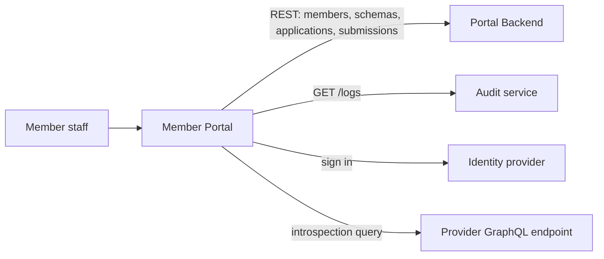

# Member Portal

The web app for staff of a member organization. As a **data provider** they register the schemas their systems expose; as a **data consumer** they register applications that request fields from those schemas. Both are submitted to an administrator for approval.

> **Status: not yet adapted to the current Portal Backend.** The pages and flows below are what the code does, but its API and sign-in code predate the Portal Backend's bearer-token and scope checks and the move to organization-unit members, so it does not work against the current stack. [Status and known gaps](#status-and-known-gaps) lists what to change. This portal is not in the Docker Compose stack.

## Overview



Stack: React 19, TypeScript, Vite, Tailwind, `@asgardeo/auth-react`. Submitted schemas and applications become real ones when an administrator approves them in the [Admin Portal](../admin/README.md).

## Quick start

From `portals/` (Node 24+, pnpm; see [portals/README.md](../../README.md)):

```bash
pnpm install
# create apps/member/public/config.js, see Configuration, then:
pnpm --filter member-portal run dev        # http://localhost:5173
```

Both the member and admin portals default to port 5173. Run them one at a time or set `VITE_PORT` (below).

## Configuration

Two layers:

- **Build time** (read by Vite from `.env`): `VITE_PORT` (default `5173`) and `VITE_BASE_PATH` (default `/`).
- **Runtime**, from `window.configs`, filled from `config.js` (loaded by `index.html`). `.env` does **not** populate it. Locally, create `apps/member/public/config.js` (git-ignored); in Docker the container writes it at startup from the environment variables below.

| `window.configs` key | Docker environment variable | Meaning |
|---|---|---|
| `API_URL` | `VITE_API_URL` | Portal Backend base URL. The code appends `/members`, `/schemas` and so on, so it must end in `/api/v1`. |
| `LOGS_URL` | `VITE_LOGS_URL` | Audit service base URL, for the log viewers. |
| `CLIENT_ID` | `VITE_CLIENT_ID` | OAuth2 client ID. |
| `BASE_URL` | `VITE_BASE_URL` | Identity provider base URL. |
| `SCOPE` | `VITE_SCOPE` | **Comma-separated** scopes. Default `openid,profile`. |
| `SIGN_IN_REDIRECT_URL`, `SIGN_OUT_REDIRECT_URL` | `VITE_SIGN_IN_REDIRECT_URL`, `VITE_SIGN_OUT_REDIRECT_URL` | OIDC redirect URLs. |

```js
// apps/member/public/config.js
window.configs = {
  API_URL: 'http://localhost:8083/api/v1',
  LOGS_URL: 'http://localhost:3001',
  CLIENT_ID: '<client id>',
  BASE_URL: 'http://localhost:8090',
  SCOPE: 'openid,profile,member:read,member:write,schema:read,schema:write,schema-submission:read,schema-submission:write,application:read,application:write,application-submission:read,application-submission:write',
  SIGN_IN_REDIRECT_URL: 'http://localhost:5173',
  SIGN_OUT_REDIRECT_URL: 'http://localhost:5173',
};
```

[.env.example](.env.example) lists the same settings with the Docker names. The other portals name these keys differently; the three conventions are compared in [portals/README.md](../../README.md#configuration).

## What it calls

| Backend | Calls |
|---|---|
| Portal Backend (`API_URL`) | `GET /members?idpUserId=` (find the signed-in user's member), `GET /schemas`, `GET` and `POST /schema-submissions`, `GET /applications`, `GET` and `POST /application-submissions` |
| Audit service (`LOGS_URL`) | `GET /logs` filtered by provider or consumer, status, date, `limit` and `offset`; `GET /logs/export` |
| Provider endpoint | A GraphQL introspection query, sent from the browser straight to the URL the user enters |

## How it works

After sign-in the portal finds the user's member (cached in `localStorage` as `member_data`) and shows these pages:

| Route | What it does |
|---|---|
| `/` | The member's profile. |
| `/schemas` | The member's approved schemas and submissions. |
| `/schemas/new` | Register a schema: enter a provider's GraphQL endpoint, upload an introspection result JSON file, or paste SDL. Set each field's access (`@accessControl`, `@source`, `@isOwner`, `@owner`, `@description` directives); the portal builds the SDL from that and submits it. |
| `/schemas/logs` | Provider-side audit logs. |
| `/applications` | The member's applications and submissions. |
| `/applications/new` | Register an application: pick fields from approved schemas and submit. |
| `/applications/logs` | Consumer-side audit logs. |

## Status and known gaps

Verified in the code, against the current [Portal Backend](../../../cmd/pb/README.md):

- **No bearer token.** No request to the Portal Backend or the audit service carries an `Authorization` header, but every Portal Backend `/api/v1` route requires one and a scope.
- **Wrong base path.** The Portal Backend serves only under `/api/v1`, while the code appends paths directly to `API_URL`.
- **Member lookup.** The portal finds its member with `GET /members?idpUserId=<sub>` and expects exactly one result. Members are now linked to an identity-provider organization unit, `idpUserId` is gone, and the list filter is `ouId`.
- **Sign-in.** The Asgardeo SDK is given hard-coded Asgardeo tenant endpoints in `src/main.tsx`, so `BASE_URL` does not choose the identity provider. The bundled ThunderID has no client registered for this portal.
- **Docker image.** The nginx content-security policy has no `connect-src`, so the browser is likely to block calls to the Portal Backend and identity provider from the container.
- **Silent fallbacks.** The schemas and applications pages show empty lists, without an error, when a request fails.
- **Placeholders.** Application registration uses a sample SDL (a `TODO` to fetch the real one from the Orchestration Engine), and `src/pages/Dashboard.tsx` is an unrouted mock.
- **Audit endpoints.** The log viewers call `/logs` and `/logs/export`, which has not been checked against the audit service version in Compose.

## Development

From `portals/`:

```bash
pnpm --filter member-portal run build      # type-check and production build
pnpm --filter member-portal run lint
```

There is no test script. From the repo root, `make run member-portal`, `make validate-build member-portal` and `make check-lint member-portal` wrap these. To build the image, use `portals/` as the context: `docker build -t member-portal -f apps/member/Dockerfile .` from `portals/`; run it with the `VITE_*` variables above and `-p 5173:80`.

Source is in [`src`](src): `pages`, `services` (API calls), `components`, `types`.

## More docs

- [portals/README.md](../../README.md): workspace, config conventions
- [Admin Portal](../admin/README.md): approves what this portal submits
- [Portal Backend](../../../cmd/pb/README.md) and its [authorization model](../../../cmd/pb/AUTHORIZATION.md)
